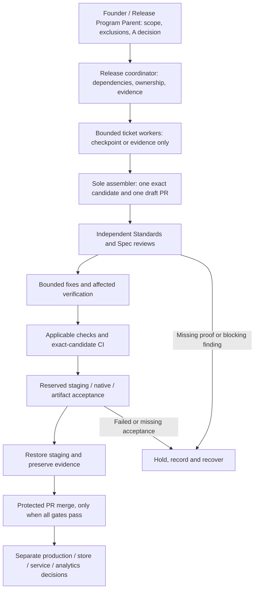
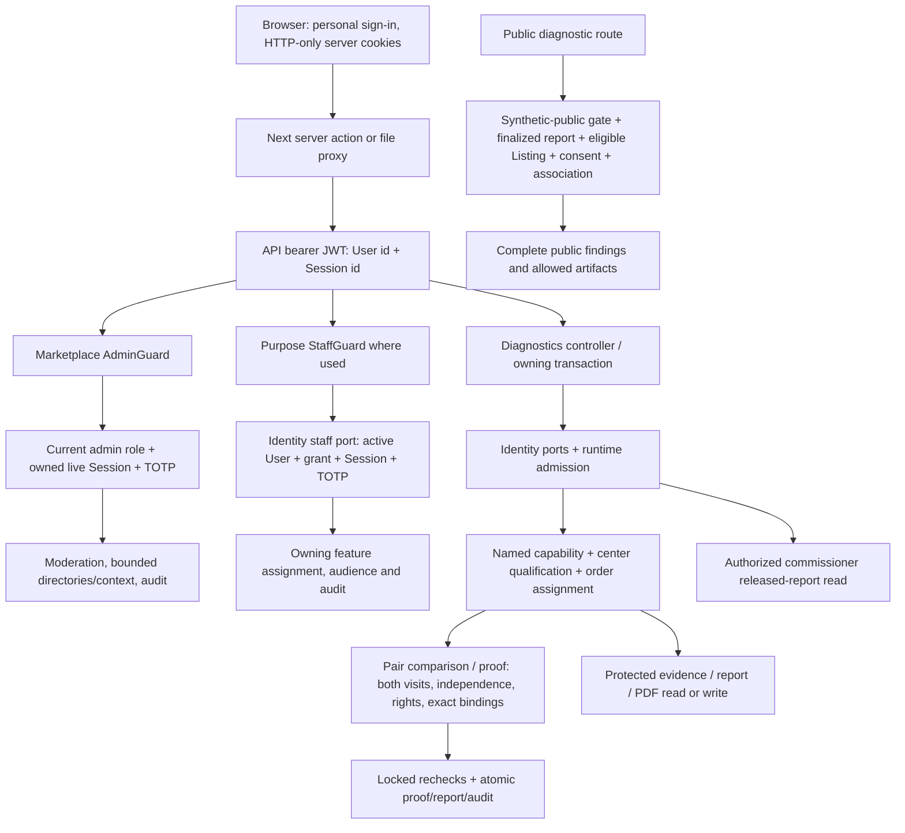

# PR #904 read-only architecture and security audit

2 November 2026. Repository Carberk/carberk. This is an independent audit, separate from Milestone A acceptance.

**Disposition: Standards blocked; Spec acceptance blocked.** The inspected code separates marketplace administration, purpose-scoped staff authority and diagnostic audience/assignment checks. That architecture is present in source. It does not establish deployed security, completed A acceptance or permission to activate a service.

## Exact identity and method

| Item | Identity |
|---|---|
| Reviewed PR | https://github.com/Carberk/carberk/pull/904 |
| Exact reviewed head | `b6dac5d17c140c8fd307a24df56d4a82ed070625` |
| Supplied base and verified merge base | `9fde309c3da17f2661fe9c266504e6e56a1b97c9` |
| Separate newer A candidate | `4feaebd70ce7f92c5fd3e96d95fc47f557758c6c` |
| Checkout during audit | Exact PR head, clean |
| Comparison | `git diff 9fde309c...b6dac5d` |

The PR diff spans 2,367 files, 273,027 additions and 4,107 deletions. This audit concentrates on the requested role, Identity, Admin, Diagnostics, persistence/cleanup and release boundaries. It is not a claim that every changed line has been exhaustively proved.

The A candidate differs from the PR head by 55 files, 4,096 additions and 53 deletions. Its later ID/time dependency fixes and worker fixture work were identified only to prevent mistaken attribution. They do not repair or replace the reviewed PR tree in this report. The product/source/test/script/configuration paths checked against the earlier review checkpoint `52d901c50` are unchanged at the PR head. Older evidence still belongs to its recorded SHA and environment.

I read AGENTS.md, CONTEXT-MAP.md, the glossary, coding/domain/workflow guidance, owning Admin/API/Identity/Diagnostics/worker/database overviews, the relevant PRDs, ADR-0098/0104/0108/0109, and the committed issue-897/PR904 execution records. No live GitHub, CI or issue metadata was fetched under the no-hosted-resources restriction. The supplied PR head and committed open/draft record define this audit target.

Only local read-only git/source inspection and a small Python schema/profile comparison ran. No tests, builds, installs, services, native/device work, deployment, hosted resources, PR changes or ref mutations were performed. The report and static evidence are under /tmp. `git diff --check` exited 2 with 28 whitespace diagnostics, mostly evidence/migration EOF whitespace. These tooling-level nits are not promoted into architectural Standards findings.

Independent Standards and Spec reviews completed on the exact PR head. Standards returned three documented P2 breaches plus one optional smell. Spec independently confirmed five P1 acceptance blockers/gaps. P1 denotes a release/acceptance blocker here, not a demonstrated vulnerability rating. No review result grants A acceptance.

Standards review: <t3-thread://v2/ce9be202-17c9-4f76-8357-807251606a41/thread:delegated-task:command%3Amcp%3A079aba9e-816b-47ec-80c4-85022005d774%3Adelegate-task%3A58c98d87-c92d-4c38-8390-ae8ea7e94164>

Spec review: <t3-thread://v2/ce9be202-17c9-4f76-8357-807251606a41/thread:delegated-task:command%3Amcp%3A079aba9e-816b-47ec-80c4-85022005d774%3Adelegate-task%3Aa77a6c37-c4cf-48f0-a8e7-dc8604f6bd33>

## For the founder

The console is becoming a place where named people perform specific duties. A mechanic does not need full marketplace moderation powers. A Support operator does not receive every private inspection document. A founder capability authorizes a named downstream operation; it does not authorize deployment or override diagnostic consent.

Four authorities remain separate:

- The founder/Release Program Parent defines scope and exclusions and alone declares A complete.
- The release coordinator owns dispatch, dependencies, the sole assembler, exact candidate identity, evidence disposition and serialized release operations.
- A ticket worker returns only its bounded checkpoint or evidence. A worker pass is not release acceptance.
- The application authorizes each person from current Identity state and the owning feature's assignment, audience and rights rules.

This follows [coding-workflow.md:13](/Users/bagtyyar/.t3/worktrees/carberk/audit-pr-904-role-diagnostics-20261102/docs/agents/coding-workflow.md:13), [ADR-0098:19](/Users/bagtyyar/.t3/worktrees/carberk/audit-pr-904-role-diagnostics-20261102/docs/adr/0098-integration-delivery-with-shared-staging-and-concise-agent-guidance.md:19) and [the A ticket map:28](/Users/bagtyyar/.t3/worktrees/carberk/audit-pr-904-role-diagnostics-20261102/docs/evidence/issue-897/a-wayfinder-ticket-map-20261030.md:28). The ticket restrictions are specific to their dispatch; they are not a transfer of the coordinator's release authority.

A remains unaccepted. Recorded ordinary full100 worker cleanup passed on its pinned source, but restricted ownership/capacity/rollback/race bodies did not run. Restoration has a concrete schema-profile refusal. The complete caller/privacy matrix, protected staff journey, locale/native/deployed evidence, combined CI and exact APK/AAB mapping remain required. The current execution record is a blocked handoff, not permission to ship.

The main risk is treating successful component evidence as proof of the complete permission and data lifecycle. No unauthorized disclosure was demonstrated by this audit. Missing adversarial and deployed evidence means that claim remains unproved. Center operation, price, capacity, equipment, consent wording, payment/refunds and real data rights are separate activation inputs under [ADR-0104:14](/Users/bagtyyar/.t3/worktrees/carberk/audit-pr-904-role-diagnostics-20261102/docs/adr/0104-center-diagnostics-with-private-and-public-reports.md:14).

## Role and capability matrix

This table describes source policy under the configured gates, not live availability. Staff duties require a current personal Session and TOTP elevation; owning features add their own scope.

| Person or duty | Authority and access | Boundary |
|---|---|---|
| Ordinary buyer/seller | Personal marketplace actions; own commissioned released inspection report | Owning a car, paying, or knowing an ID grants no other buyer's report or restricted identity/proof material |
| Dealership owner/sales | Current membership controls business inventory/enquiries; owner controls roster/settings | Membership is separate from Marketplace Role and diagnostic staff duty |
| Marketplace admin | Current `role=admin` plus live owned elevated Session; moderation, bounded directories/context, audit | No implicit private-service, diagnostics or analytics capability |
| Support/history operator | `support.operations`, `history.fulfilment`, payment verification/history/export grants as applicable | Owning service assignment, purpose, artifact rights and audit remain required |
| Diagnostic reception | `diagnostics.reception` plus center qualification and relevant order scope | Intake/appointment/assignment work, not technician authorship or reviewer release |
| Diagnostic technician | `diagnostics.technician` plus center qualification and order assignment | Authors own visit findings/identity; cannot release a public report merely as its author |
| Diagnostic reviewer | `diagnostics.reviewer` plus qualification/assignment | Reviews/releases; public author separation; audited private self-review; pair proof issuance requires both visits and independence |
| Checklist manager | `diagnostics.templates` plus center qualification | Publishes future checklist versions, does not rewrite started/finalized snapshots |
| Staff/founder authority | `staff.manage`; founder-controlled changes also require `founder.control` | No self-grant; reason/audit required; HTTP cannot grant root `founder.control` |
| Analytics duty | `analytics.aggregate` or `analytics.investigate` | Separate analytics contract and activation gate; shared console gives no automatic access |

Sources: [staff allowlist:3](/Users/bagtyyar/.t3/worktrees/carberk/audit-pr-904-role-diagnostics-20261102/packages/contracts/src/schemas/staff.ts:3), [staff grant policy:12](/Users/bagtyyar/.t3/worktrees/carberk/audit-pr-904-role-diagnostics-20261102/apps/api/src/modules/identity/domain/staffPolicy.ts:12), [staff bootstrap:3](/Users/bagtyyar/.t3/worktrees/carberk/audit-pr-904-role-diagnostics-20261102/docs/prd/ops/87-staff-bootstrap-runbook.md:3), [diagnostic staff policy:36](/Users/bagtyyar/.t3/worktrees/carberk/audit-pr-904-role-diagnostics-20261102/docs/prd/features/50-reports-tier.md:36), [ADR-0013:27](/Users/bagtyyar/.t3/worktrees/carberk/audit-pr-904-role-diagnostics-20261102/docs/adr/0013-user-role-split.md:27). The enum's historical `moderator` label is not an authorization bypass for current routes that explicitly require `admin`.

## For developers

### Request path and Identity boundary

The browser signs in personally. The Admin server holds tokens in HTTP-only cookies; server actions and file proxies forward bearer authentication to the API. Navigation uses a current staff summary and a separate actual marketplace-admin check. A visible link does not authorize a request. Origin and local return-path checks protect the browser-posted bridge; token renewal does not extend TOTP elevation. The single-process/replica restriction from ADR-0090 remains an operational constraint.

At the API, the global JWT guard establishes token identity, not every current permission. `AdminGuard` ignores a stale JWT role as authority: it queries current `isAdmin`, then calls Identity's elevation port to check that the Session exists, belongs to the User and has unexpired Session/TOTP deadlines. `StaffGuard` reads the named route capability and calls `STAFF_AUTHORITY_PORT`, which validates the current User, Session, grant and elevation.

Diagnostics does not apply marketplace `AdminGuard` wholesale. Its controllers support commissioner and staff paths, and its adapters call `DiagnosticAuthority` and Identity ports inside the owning transaction. That deeper check is essential for grant/session revocation racing a write.

Other contexts import Identity through `identity.public.ts`. Public ports include identity checks/reads/admin operations, admin Session elevation, staff authority, business authority, staff bindings and publisher bindings. Identity keeps repositories and Session writes private. Binding generations let Diagnostics bind proofs to current staff/publisher facts without importing Identity internals.

Sources: [admin overview:7](/Users/bagtyyar/.t3/worktrees/carberk/audit-pr-904-role-diagnostics-20261102/apps/admin/CONTEXT.md:7), [staff-session.ts:8](/Users/bagtyyar/.t3/worktrees/carberk/audit-pr-904-role-diagnostics-20261102/apps/admin/src/lib/staff-session.ts:8), [global guards:79](/Users/bagtyyar/.t3/worktrees/carberk/audit-pr-904-role-diagnostics-20261102/apps/api/src/app.module.ts:79), [AdminGuard:42](/Users/bagtyyar/.t3/worktrees/carberk/audit-pr-904-role-diagnostics-20261102/apps/api/src/common/admin.guard.ts:42), [StaffGuard:11](/Users/bagtyyar/.t3/worktrees/carberk/audit-pr-904-role-diagnostics-20261102/apps/api/src/common/staff.guard.ts:11), [CheckStaffAuthority:12](/Users/bagtyyar/.t3/worktrees/carberk/audit-pr-904-role-diagnostics-20261102/apps/api/src/modules/identity/application/CheckStaffAuthority.ts:12), [Identity public ports:1](/Users/bagtyyar/.t3/worktrees/carberk/audit-pr-904-role-diagnostics-20261102/apps/api/src/modules/identity/identity.public.ts:1), [domain boundary rule:9](/Users/bagtyyar/.t3/worktrees/carberk/audit-pr-904-role-diagnostics-20261102/docs/agents/domain.md:9).

### Assignment, audience, ownership and proof are different checks

`DiagnosticAuthority.center` requires the named staff grant plus a nonrevoked center qualification whose deadline is in the future. `order` checks current identity/runtime admission, locks and rereads the order, and requires the order assignment for staff work. Commissioner fallback is permitted only on the appropriate ordinary read path. A released snapshot is needed for a commissioner to read a report; restricted identity records do not use that fallback.

Public reading is separate. The synthetic-public runtime gate must be open; the report must be finalized, retained and not withdrawn; the synthetic order must have public audience, publication authorization and validated association; the current Listing and owner/business must remain eligible and match the saved identity digest. Private identifiers/provenance do not become public merely because the findings are public. Public unavailability uses a generic unavailable/not-found response.

Continuity between predecessor visit A and new visit B requires retained visit identity evidence. Pair comparison requires current technician/reviewer authority on both visits. Issuance requires a qualified reviewer assigned to both, distinct from B's linking technician; public transfer adds the stronger independence and publisher rules. Private pairs require the same nonnull commissioner. Mixed audiences refuse.

The proof binds exact report/order versions, snapshot and identity hashes, provenance/rights, issuer Session and staffing/publisher facts. Consumption locks and rereads current authority, rights, versions, invalidation and uniqueness, then atomically consumes the proof, creates B's own empty draft and audits. Exact retry bindings and same-Session request recovery avoid duplicate work. Limited B handoff/result recovery does not grant access to A's report or restricted proof payload.

Authenticated ownership grants are a further requirement for automatic public continuity. A grant needs truthful source authority and explicit rights end; both visits need immutable ownership anchors and an irreversible change witness. Equal VIN text or restored current Listing values cannot substitute. Authored source support is not acceptance of automatic admission or real source rights.

Sources: [DiagnosticAuthority:55](/Users/bagtyyar/.t3/worktrees/carberk/audit-pr-904-role-diagnostics-20261102/apps/api/src/modules/diagnostics/infrastructure/DiagnosticAuthority.ts:55), [ReportAccess:16](/Users/bagtyyar/.t3/worktrees/carberk/audit-pr-904-role-diagnostics-20261102/apps/api/src/modules/diagnostics/infrastructure/DiagnosticReportAccess.ts:16), [private identity history:370](/Users/bagtyyar/.t3/worktrees/carberk/audit-pr-904-role-diagnostics-20261102/apps/api/src/modules/diagnostics/infrastructure/PrismaDiagnosticIntake.ts:370), [pair comparison:140](/Users/bagtyyar/.t3/worktrees/carberk/audit-pr-904-role-diagnostics-20261102/apps/api/src/modules/diagnostics/infrastructure/PrismaDiagnosticReports.ts:140), [proof issuance:546](/Users/bagtyyar/.t3/worktrees/carberk/audit-pr-904-role-diagnostics-20261102/apps/api/src/modules/diagnostics/infrastructure/PrismaDiagnosticContinuityProofs.ts:546), [consumption:619](/Users/bagtyyar/.t3/worktrees/carberk/audit-pr-904-role-diagnostics-20261102/apps/api/src/modules/diagnostics/infrastructure/PrismaDiagnosticContinuityProofs.ts:619), [ADR-0108:39](/Users/bagtyyar/.t3/worktrees/carberk/audit-pr-904-role-diagnostics-20261102/docs/adr/0108-pair-bound-diagnostic-reinspection-continuity-proof.md:39), [ADR-0109:16](/Users/bagtyyar/.t3/worktrees/carberk/audit-pr-904-role-diagnostics-20261102/docs/adr/0109-authenticated-ownership-grants-for-automatic-diagnostic-continuity.md:16).

### Persistence and worker cleanup

PostgreSQL persists Users/Sessions/grants, center qualifications, order assignments, pinned checklist versions, immutable raw visit identity, structured classified evidence, ownership grants/components/anchors, report state/snapshots, restricted proofs, retry requests and audits. Binary evidence and generated PDFs have separate object and lifecycle records.

The source command kernel prepares the complete retained graph before writes, uses a shared lock/revalidation protocol, then finishes the declared command. Migration text does not prove the serving database's trigger, guard or role state; this audit did not inspect or activate any deployed database. Caller code must not prepare a late partial graph beneath feature locks. This complexity spans Identity, Listings, business membership, Diagnostics and worker cleanup; the required caller/race matrices therefore cannot be replaced by an isolated happy-path test.

The worker renders the finalized snapshot/locale into separately leased PDF artifacts. Rendering/storage failures retry without creating a report revision. Rights expiry and account erasure remove restricted identity/proof/ownership material according to its classification while retaining permitted report facts and minimal retry bindings. No blanket inspection TTL is approved.

Ownership expiry freezes up to 100 due grant IDs and separate component IDs, then handles at most ten intentions per transaction. The complete derived graph remains subject to the kernel cap; an over-cap connected graph must refuse, not be silently divided. Cleanup checks exact object keys and epochs, waits out write leases, deletes and verifies bytes, and records completion/retry state.

Sources: [prepared command:64](/Users/bagtyyar/.t3/worktrees/carberk/audit-pr-904-role-diagnostics-20261102/packages/db/src/diagnostic-source-command.ts:64), [worker preparation:31](/Users/bagtyyar/.t3/worktrees/carberk/audit-pr-904-role-diagnostics-20261102/apps/worker/src/jobs/diagnostics/DiagnosticWorkerPreparation.ts:31), [rights and ownership expiry:277](/Users/bagtyyar/.t3/worktrees/carberk/audit-pr-904-role-diagnostics-20261102/apps/worker/src/jobs/diagnostics/DiagnosticArtifactWorker.ts:277), [exact object cleanup:433](/Users/bagtyyar/.t3/worktrees/carberk/audit-pr-904-role-diagnostics-20261102/apps/worker/src/jobs/diagnostics/DiagnosticArtifactWorker.ts:433), [ADR-0104:26](/Users/bagtyyar/.t3/worktrees/carberk/audit-pr-904-role-diagnostics-20261102/docs/adr/0104-center-diagnostics-with-private-and-public-reports.md:26).

## Release orchestration

The coordinator owns integration and serialized release operations; ticket workers stop at handoff. [run-queue:14](/Users/bagtyyar/.t3/worktrees/carberk/audit-pr-904-role-diagnostics-20261102/.claude/skills/run-queue/SKILL.md:14) and [run-issue:10](/Users/bagtyyar/.t3/worktrees/carberk/audit-pr-904-role-diagnostics-20261102/.claude/skills/run-issue/SKILL.md:10) define that difference. This read-only audit authorizes none of those mutations.

## Admin and diagnostics authorization

Diagnostics calls the staff authority port inside its transaction instead of treating the route guard or workspace navigation as its complete policy. Every failed owning check must stop the operation; the diagram is a source explanation, not runtime proof.

## For a nontechnical reader

Everyone signs in as themselves. The system can then give that person a specific job. A receptionist organizes an inspection. A technician records what they observed. A reviewer decides whether a complete report can be released. A person managing car adverts does not automatically receive those jobs.

A private buyer report stays with the buyer who commissioned it and the staff specifically authorized to work on it. The seller's permission to inspect the car is not permission to read the buyer's report. A later buyer must arrange their own inspection. A public report needs separate publication consent and a confirmed match to the advertised car.

Photos of identity evidence, VINs, supporting documents and proof notes can reveal people and ownership history. The system keeps those records more restricted than the released findings. A continuity link says that two visits concern the same vehicle under the allowed rules; it does not copy an old report or share its private material.

Staff see the sections their current duties permit. If their Session/TOTP expires, the console asks them to verify again; removed duties should refuse the next protected action. Customers see dated findings and mileage, and may wait for a PDF while the complete reader is already available. Corrections preserve history. A report is an inspection record, not a guarantee that a car is safe. These are source/specification behaviors; the remaining acceptance work must establish the integrated experience.

## Implementation and evidence status

| Classification | What this audit can say |
|---|---|
| Implemented in inspected source | Separate admin/staff authority; Identity public ports; center/order/audience checks; snapshot/reviewer rules; pair proof binding/consumption; protected files; prepared persistence and cleanup code |
| Partial | Staff continuity journey and cleanup have focused/component evidence; ordinary full100 has a specific recorded pass; reset direct guards/cycle refusal have focused passes |
| Unproved or failed required gates | Restricted ownership/capacity/rollback/races, complete caller/privacy matrix, real reset lifecycle and restoration, protected multi-actor/native/locale journey, combined CI, deployed acceptance and exact artifact mapping |
| Out of scope | B prototype completion, analytics product completion/real collection/activation, public real-service opening, production promotion and store submission |

The recorded full100 pass at [native-acceptance-20261030.md:3](/Users/bagtyyar/.t3/worktrees/carberk/audit-pr-904-role-diagnostics-20261102/docs/evidence/issue-897/worker-fresh-ready-20261029/native-acceptance-20261030.md:3) explicitly excludes the remaining gates. Source-only implementation is not accepted behavior.

## Short glossary

| Term | Meaning |
|---|---|
| Marketplace Role | Platform identity such as buyer, seller or admin, separate from dealership membership |
| Capability / grant | A named duty and the current record permitting a person to perform it |
| Session / elevation | A live sign-in record; elevation is the separately expiring personal TOTP check |
| Qualification / assignment | Approval to perform a diagnostic duty at a center; responsibility on a particular order |
| Commissioner / audience | Who commissioned the inspection; who may read its released report |
| Provenance / rights | Where evidence came from and the permitted purpose, use, retention and deletion rules |
| Snapshot | An immutable released report version |
| Continuity proof | Restricted single-use exact binding between an old report and a new visit; it transfers no report access |
| Prepared source command | A declared mutation whose complete retained graph, locks, rechecks and effects are validated together |
| Milestone A / visit A | The internal release milestone / the predecessor inspection. These are different uses of A |

Canonical vocabulary: [GLOSSARY.md:9](/Users/bagtyyar/.t3/worktrees/carberk/audit-pr-904-role-diagnostics-20261102/docs/domain/GLOSSARY.md:9), [inspection and proof terms:165](/Users/bagtyyar/.t3/worktrees/carberk/audit-pr-904-role-diagnostics-20261102/docs/domain/GLOSSARY.md:165).

## Limitations and execution policy

PR #904 is open/draft in the supplied/committed record; no live status or current checks were queried. The exact PR and A candidate heads differ. A is not accepted. Analytics activation is separate. No public or production activation follows from this PR, this audit, a stored report, a green component test or an operator bootstrap receipt.

Synthetic diagnostic intake/public reading is explicitly limited to test/staging and runtime allowlists by [diagnosticRuntime.ts:6](/Users/bagtyyar/.t3/worktrees/carberk/audit-pr-904-role-diagnostics-20261102/apps/api/src/modules/diagnostics/infrastructure/diagnosticRuntime.ts:6). Full-v3 campaign admission is a bounded separate path for template/private intake and does not approve a real center or payment service. Real service readiness remains human-owned.

The founder changed the execution policy during this audit. This thread's model selection was read back as `codex_work/gpt-6.1-sol`, xhigh, `serviceTier=default`. The first Spec worker started with priority before that update. My subsequent thread-configuration request interrupted its run before a final report. Its partial source findings were preserved and its task was closed; a new independent Spec completion review finished at xhigh/default. The Standards reviewer also used xhigh/default. No live provider-run change is claimed. No new priority run was requested after the update.

## Standards findings, ranked within this axis

### S1: P2: Time and randomness are ambient dependencies in the reviewed UI

Confirmed at [DiagnosticIdentity.tsx:82](/Users/bagtyyar/.t3/worktrees/carberk/audit-pr-904-role-diagnostics-20261102/apps/admin/src/app/diagnostics/DiagnosticIdentity.tsx:82) and line 102, [DiagnosticContinuity.tsx:192](/Users/bagtyyar/.t3/worktrees/carberk/audit-pr-904-role-diagnostics-20261102/apps/admin/src/app/diagnostics/DiagnosticContinuity.tsx:192), and [UploadRightsForm.tsx:14](/Users/bagtyyar/.t3/worktrees/carberk/audit-pr-904-role-diagnostics-20261102/apps/admin/src/app/(admin)/services/UploadRightsForm.tsx:14). New command IDs use global `crypto.randomUUID()`; rights-expiry validation reads global `Date.now()`.

Governing rule: [coding-standards.md:23](/Users/bagtyyar/.t3/worktrees/carberk/audit-pr-904-role-diagnostics-20261102/docs/agents/coding-standards.md:23), "Time, randomness, storage, network and native modules come in through a parameter, a port or a provider." These modules own command identity/retry and expiry decisions. Supply ID/time dependencies at the actual production composition point and verify the real components with fixed IDs/time, exact retry identity and expiry boundaries. A prop that defaults to the global inside the feature would not by itself prove production composition.

This is a documented Standards breach and testability risk, not a demonstrated authorization exploit. It is already accepted/open in [A-01:15](/Users/bagtyyar/.t3/worktrees/carberk/audit-pr-904-role-diagnostics-20261102/docs/evidence/issue-897/a-01-standards-spec-review-20261030.md:15). The later A branch has separate fix commits; they are not in the PR head reviewed here.

### S2: P2: Staff-grant mutation authorization reads an ambient execution clock

[PrismaStaffAuthority.ts:66](/Users/bagtyyar/.t3/worktrees/carberk/audit-pr-904-role-diagnostics-20261102/apps/api/src/modules/identity/infrastructure/PrismaStaffAuthority.ts:66) repeats the security check under transition locks using `new Date()`, even though [ChangeStaffGrant.ts:12](/Users/bagtyyar/.t3/worktrees/carberk/audit-pr-904-role-diagnostics-20261102/apps/api/src/modules/identity/application/ChangeStaffGrant.ts:12) receives an injected clock. The adapter constructor receives only Prisma. This violates the same [Modules rule 5](/Users/bagtyyar/.t3/worktrees/carberk/audit-pr-904-role-diagnostics-20261102/docs/agents/coding-standards.md:23).

Action: inject an execution clock into the adapter and sample it after the locks. Preserve the fresh check, rather than reusing the earlier mutation timestamp, so waiting cannot extend grant/session authority. Verify the expiry boundary through the owning mutation. This is a dependency/verification flaw, not an observed stale-authority exploit.

### S3: P2: New proxy tests replace repository-owned authentication/configuration modules

[evidence-proxy.spec.ts:5](/Users/bagtyyar/.t3/worktrees/carberk/audit-pr-904-role-diagnostics-20261102/apps/admin/src/app/diagnostics/evidence-proxy.spec.ts:5) and line 6 mock `@/lib/cookies` and `@/lib/api-config`. Governing rule: [coding-standards.md:30](/Users/bagtyyar/.t3/worktrees/carberk/audit-pr-904-role-diagnostics-20261102/docs/agents/coding-standards.md:30), "Do not mock this repository's own components, hooks or modules."

Action: retain the real wrappers and substitute their framework-cookie, environment and network boundaries. Verify protected proxy behavior through that composition, including missing/expired authority and byte/denial handling. The current tests cannot establish the real wrapper-to-route wiring; this does not prove that the production proxy leaks evidence.

The reviewer also noted possible Duplicated Code in `DiagnosticIdentity.tsx:66` and `DiagnosticContinuity.tsx:51`, including `if (fence.current || !alive.current) return` and lifecycle handling. This is an optional heuristic, not a documented violation. Different recovery policies may justify keeping it separate; it is not an acceptance blocker.

## Spec findings, ranked within this axis

### P1: SP1: The exact candidate cannot pass retained-schema restoration planning

[scripts/staging-schema.mjs:73](/Users/bagtyyar/.t3/worktrees/carberk/audit-pr-904-role-diagnostics-20261102/scripts/staging-schema.mjs:73) omits four migrations present in the 102-migration PR tree: `20261026016200_diagnostic_maintenance_compatibility`, `20261026016300_diagnostic_registry_metadata_lookup`, `20261026016400_diagnostic_source_key_predicate` and `20261029190000_operational_reset_row_admission`. The validator refuses the mismatch at [line 216](/Users/bagtyyar/.t3/worktrees/carberk/audit-pr-904-role-diagnostics-20261102/scripts/staging-schema.mjs:216). My static inventory/hash comparison independently confirms the mismatch; no runtime was started.

The saved [A-04 receipt:54](/Users/bagtyyar/.t3/worktrees/carberk/audit-pr-904-role-diagnostics-20261102/docs/evidence/issue-897/a-04-reset-runtime-20261030/receipt.md:54) records the same RED and obstructed downstream assertions. This conflicts with the required restored-fixture gate at [A ticket map:140](/Users/bagtyyar/.t3/worktrees/carberk/audit-pr-904-role-diagnostics-20261102/docs/evidence/issue-897/a-wayfinder-ticket-map-20261030.md:140) and the restoration requirement in [ADR-0098:22](/Users/bagtyyar/.t3/worktrees/carberk/audit-pr-904-role-diagnostics-20261102/docs/adr/0098-integration-delivery-with-shared-staging-and-concise-agent-guidance.md:22).

Action: have the authorized reset owner review compatibility of the exact schema/migration inventory, repair only the approved profile contract, and obtain the affected restoration and blocked negative-path proof. Do not bypass the validator or treat all 22 downstream failures as independent product defects. The present behavior is a safe refusal and a release blocker; this audit did not observe data destruction.

### P1: SP2: Required restricted ownership, capacity, rollback and race acceptance was skipped

[DiagnosticWorkerOwnershipBatch.e2e.spec.ts:117](/Users/bagtyyar/.t3/worktrees/carberk/audit-pr-904-role-diagnostics-20261102/apps/worker/src/jobs/diagnostics/DiagnosticWorkerOwnershipBatch.e2e.spec.ts:117) requires a separate ordinary fixture manifest. The saved [A-02 receipt:33](/Users/bagtyyar/.t3/worktrees/carberk/audit-pr-904-role-diagnostics-20261102/docs/evidence/issue-897/a-02-worker-restricted-20261030/receipt.md:33) records ten skipped test bodies after that prerequisite failed. The ordinary full100 pass and 12/12 restricted preparation pass do not establish these outcomes.

Governing requirement: [A ticket map:85](/Users/bagtyyar/.t3/worktrees/carberk/audit-pr-904-role-diagnostics-20261102/docs/evidence/issue-897/a-wayfinder-ticket-map-20261030.md:85), "PASS when restricted-role erasure is private and complete, capacity refusal is bounded, rollback leaves no partial ownership, and both race orders converge without duplicate delivery or leaked data." [ADR-0109:22](/Users/bagtyyar/.t3/worktrees/carberk/audit-pr-904-role-diagnostics-20261102/docs/adr/0109-authenticated-ownership-grants-for-automatic-diagnostic-continuity.md:22) requires complete source/erasure closure.

Action: the evidence owner must supply lawful ordinary per-case fixtures on the exact candidate and complete the unchanged required cases, preserving the restricted role, full graph, rollback snapshots, both race orders and cleanup. This is an evidence/setup failure, not a proven production cleanup bug.

### P1: SP3: The cross-context caller, namespace, privacy and erasure matrix remains unproved

The current execution record retains partial historical caller/closure evidence at [milestone-a-execution-20261029.md:23](/Users/bagtyyar/.t3/worktrees/carberk/audit-pr-904-role-diagnostics-20261102/docs/evidence/issue-897/milestone-a-execution-20261029.md:23), and [coordinator dispatch:17](/Users/bagtyyar/.t3/worktrees/carberk/audit-pr-904-role-diagnostics-20261102/docs/evidence/issue-897/a-coordinator-dispatch-20261030.md:17) leaves A-03 waiting. Diagnostic-only positives do not establish cross-context privacy.

Governing requirements: [A ticket map:114](/Users/bagtyyar/.t3/worktrees/carberk/audit-pr-904-role-diagnostics-20261102/docs/evidence/issue-897/a-wayfinder-ticket-map-20261030.md:114), every required privacy cell green, and [ADR-0104:40](/Users/bagtyyar/.t3/worktrees/carberk/audit-pr-904-role-diagnostics-20261102/docs/adr/0104-center-diagnostics-with-private-and-public-reports.md:40), private/public denial, removal, erasure and protected delivery acceptance.

Action: finish the original caller, namespace, audience, cross-order and erasure assertions on the coordinator's authorized exact candidate. Record each actor, expected disclosure, actual response and cleanup. Preserve unresolved assertions from service and other contexts. This is missing acceptance evidence; no disclosure was demonstrated.

### P1: SP4: Lawful reset lifecycle and integrated restoration remain partial

[A-04 receipt:45](/Users/bagtyyar/.t3/worktrees/carberk/audit-pr-904-role-diagnostics-20261102/docs/evidence/issue-897/a-04-reset-runtime-20261030/receipt.md:45) leaves obsolete-campaign disposition, real executor refusal/rollback, 240-second expiry, post-disposal unfinished-commit and provider/storage/horizon/handoff proof missing or unrun. Direct guard and offline fake passes establish narrower behavior.

Governing requirement: [A ticket map:132](/Users/bagtyyar/.t3/worktrees/carberk/audit-pr-904-role-diagnostics-20261102/docs/evidence/issue-897/a-wayfinder-ticket-map-20261030.md:132), the explicit reset lifecycle matrix, and its [restoration gate:140](/Users/bagtyyar/.t3/worktrees/carberk/audit-pr-904-role-diagnostics-20261102/docs/evidence/issue-897/a-wayfinder-ticket-map-20261030.md:140).

Action: after resolving SP1, complete the unchanged real lifecycle cases and establish actual restoration through the authorized coordinator. Keep offline, focused database and real-provider outcomes separately labeled. No destructive mutation is inferred from the absent proof.

### P1: SP5: The selected integrated staff journey and release package lack required evidence

The saved independent [Spec record:41](/Users/bagtyyar/.t3/worktrees/carberk/audit-pr-904-role-diagnostics-20261102/docs/evidence/issue-897/a-11-spec-review-20261030.md:41) and [coordinator handoff:27](/Users/bagtyyar/.t3/worktrees/carberk/audit-pr-904-role-diagnostics-20261102/docs/evidence/issue-897/a-coordinator-handoff-20261030.md:27) keep protected multi-actor/native EN/RU/TK, combined CI, deployed/restoration and exact APK/AAB gates open. UI source and focused/rendered fixes are partial evidence.

Governing requirements: [Admin PRD:175](/Users/bagtyyar/.t3/worktrees/carberk/audit-pr-904-role-diagnostics-20261102/docs/prd/features/40-admin.md:175), consolidated browser/native/deployed verification, [A ticket map:163](/Users/bagtyyar/.t3/worktrees/carberk/audit-pr-904-role-diagnostics-20261102/docs/evidence/issue-897/a-wayfinder-ticket-map-20261030.md:163), a usable private journey in all three locales with runtime/race proof, [CI gate:186](/Users/bagtyyar/.t3/worktrees/carberk/audit-pr-904-role-diagnostics-20261102/docs/evidence/issue-897/a-wayfinder-ticket-map-20261030.md:186), and [artifact gate:230](/Users/bagtyyar/.t3/worktrees/carberk/audit-pr-904-role-diagnostics-20261102/docs/evidence/issue-897/a-wayfinder-ticket-map-20261030.md:230). [ADR-0098:23](/Users/bagtyyar/.t3/worktrees/carberk/audit-pr-904-role-diagnostics-20261102/docs/adr/0098-integration-delivery-with-shared-staging-and-concise-agent-guidance.md:23) and [release scope:11](/Users/bagtyyar/.t3/worktrees/carberk/audit-pr-904-role-diagnostics-20261102/docs/prd/ops/88-play-console-submission.md:11) retain the separate merge/production/store decisions.

Action: the release coordinator should obtain the remaining exact-candidate evidence after source fixes and prerequisites, preserving the Program Parent's A-completion decision and the separate production/store/analytics gates. These are actions for the authorized delivery process; this read-only audit authorizes none of them.

Axis summary: Standards has 3 confirmed documented P2 breaches and 1 optional smell. Spec has 5 actionable P1 acceptance blockers/gaps. No critical exploit or actual leak is claimed.
