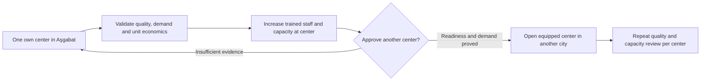

# Carberk inspection program and center scaling strategy

> Proposed operational revision, founder direction captured 2026-10-14. Not an operating approval, scheduled delivery commitment or implemented service. The document remains the future scaling strategy. First launch is one prepared center in Aşgabat; future growth is also center-based. Cars come to centers. Traveling inspectors and dispatch to sellers are excluded at every stage. Formal ADR reconciliation and the decisions below still apply.

## Initial operation

The founder is preparing one diagnostic center in Aşgabat. Start with one understandable service plan covering mechanic-approved physical checks and computer diagnostics. Personal sellers, dealerships and buyers may request it. Use the same standards regardless of who owns the vehicle or pays.

The product capability and access rules live in [feature 50](../features/50-reports-tier.md), output in [feature 51](../features/51-pdf-export.md), and journeys in [flow 66](../flows/66-diagnostic-inspection.md). This document owns real service scope, staffing, economics and readiness. It does not independently define report permissions or checklist fields.

Do not promise an inspector visit, multiple cities/branches, a lift, dynamometer, teardown, specific scan capabilities, fault detection coverage or turnaround before the center validates them. No number of checks, overall grade, repair guarantee, insurance cover or buyer compensation is established here.

## Two customer purposes

A buyer may commission a private report for their own purchase decision. The vehicle owner must authorize physical access. A seller or dealership may commission a public listing inspection with recorded publication authority. Public report readership is free; the service may have its agreed fee.

A private report does not become public if its buyer walks away. Another buyer cannot automatically receive or buy access to that private report. They may arrange their own inspection with owner authorization; the seller may arrange a public report. Private-to-public conversion and reusing another customer's report are outside the initial proposed flow until approved.

Customer terms must explain who receives the report before work starts. Commissioner, payer, vehicle owner and Listing seller can be different people. Staff do not promise privacy from physical-access authorization or claim control over copies a recipient later forwards.

## Economics and booking

Dealer access to Carberk remains free. Diagnostic service pricing is a separate business decision. Accepted direction is one transparent service price with payment at the center and no initial online payment integration. The actual price, included scope, tax/receipt treatment, duration and staffing cost are unknown.

Manual appointment confirmation is sufficient initially. A requested time is not a confirmed slot. Phone/walk-in intake may be recorded by an authorized operator; any app request entry opens only for a real ready service. Publish operating hours, intake instructions, supported vehicles, limits and agreed price before accepting customers.

Cancellation, no-show, incomplete inspection, repeat inspection, disputes and refunds need explicit terms. Not purchasing the car is a normal possible result of a diagnostic service, but no refund rule is silently adopted by this statement. Do not reuse historical willingness-to-pay survey amounts as the actual fee.

Do not let the payer choose favorable findings, pay for a better result or gain automatic search priority. Report availability does not certify a car. No ranking boost or tier grading is approved for this launch proposal.

## Staff and repeatable work

Staff use personal identities with scoped capabilities, assignments and audit history. Technician, reviewer and template-manager are proposed capabilities; public review uses a different qualified person, private self-review is explicitly audited, and privileged release/withdrawal requires current scoped elevation. Do not give mechanics general moderation/admin privileges to reach an authoring screen.

A versioned checklist records check descriptions, applicability, method/equipment limits and required evidence. Mechanics review and revise it as the center is prepared. Publish a validated version for actual use; started inspections retain their pinned version. No default Normal result and no deletion of inconvenient findings.

The historical [S9b pilot rubric](inspection-rubric-v1.md) remains input for the free concierge experiment. The 36-check capability PDF and two-page body worksheet are mechanic-review drafts. They are not already validated service scope or proof that equipment exists. Their exact check counts are not requirements.

Use original/licensed body diagrams informed by [published provider samples](https://otorapor.com/ornek-oto-ekspertiz-raporlari). Train staff to distinguish observed damage, repair/repaint evidence and supported accident history. A repainted panel alone does not establish a crash. Record uncertainty, limitations and unperformed checks in customer language.

## Preparation and launch gates

Software design and implementation preparation can progress while mechanics refine the checklist. Production execution still follows repository ADR/specification approval and issue workflow. Public service opening is a separate gate.

[ADR-0037](../../adr/0037-trust-inspection-competitive-wedge.md) commits to a manual pilot with no inspector app and gates the larger operation on evidence. [ADR-0057](../../adr/0057-defer-the-in-app-inspection-demand-signal.md) bans release inspection demand prompts and keeps interest capture disabled. A new accepted ADR must explicitly reconcile the real one-center service and worker portal before production execution. Do not treat the old interest endpoint as booking, and do not advertise an unavailable service through a disabled or coming-soon CTA.

Before opening real requests, record evidence for:

- Center readiness, mechanic competence, equipment and supported vehicle types.
- Approved checklist version, actual measured completion effort, scope limits and evidence instructions.
- Founder-approved price, included service, payment receipt process, hours and manual confirmation process.
- Physical-access/publication consent, private/public customer explanations, privacy/retention terms and staff authorization.
- Report review, correction/reinspection, dispute handling and safety-concern communication. Exact promises require approved wording.
- A full real sample inspection from intake through reader and PDF with findings, unchecked scope and body map reviewed by mechanics and fluent Turkmen readers.
- Tested private/public access, evidence delivery, draft recovery, template history and correction traceability.
- Named responsibility for customer support and handling booking/PDF outages. Paper fallback, later data entry and evidence custody need an agreed process if offered.

No new center branch, mobile inspector app, automated scheduling, online payment, external repair marketplace or AI damage detection is required for this initial scope.

## Learning without ranking changes

Record real requests, confirmed visits, completed/incomplete inspections, actual work time/cost, buyer comprehension, complaints and correction rates. Keep phone taps separate from completed calls and inspection completion separate from vehicle purchases. Determine which findings changed decisions without inventing conversion outcomes.

A single center creates geographic access differences. Evaluate service quality and truthful report use before revisiting ranking. An inspection fee plus automatic priority can become pay-for-placement; current policy remains in force. Any later change needs an explicit product decision and evidence, not a hidden implementation adjustment.

## Future scaling strategy

The founder clarified that this document is the scaling plan, not merely a launch checklist. Preserve that horizon while separating it from the first one-center release. Additional cities, branches, employees and capacity are future bets requiring evidence and their own approval. Every stage inspects cars at centers. No regional coverage claim can be fulfilled by sending inspectors to seller locations.

### Historical scale hypotheses to revalidate

The earlier strategy's estimates remain useful for scenario planning, not a hiring schedule or demand forecast. The calendar below is illustrative elapsed time after a future approved operational start. It does not schedule repository sprints or promise service outside a ready center.

| Historical horizon | Future coverage scenario | Historical technician count hypothesis | Historical monthly completion hypothesis |
|---|---|---:|---:|
| First 0–3 months | One Aşgabat center, learning operation | 1–2 | 30–50 |
| 4–9 months | More capacity at the same center | 3–5 | 80–150 |
| Year 2 | Consider a separately ready Mary center | 6–9 total | 180–300 |
| Year 3 | Consider Türkmenabat center after validation | 9–12 total | 300–450 |
| Year 4–5 | Additional regional centers only when justified | 12–18 total | 500–700 |

These numbers were not derived from measured demand, available bays or validated check duration. Coverage expands only when the next physical center is ready. Regional demand without a center is uncovered demand, not permission to offer a traveling service. Staff numbers do not alone establish capacity.

Estimate actual capacity per center from available bays, staffed hours, approved inspection duration, equipment bottlenecks, report/review time and observed utilization. Reserve time for retests, calibration, maintenance, training, customer explanation and report corrections. Do not hire to fill an invented volume target.

### Hiring, training and supervision

The old strategy's candidate profile remains a hypothesis: practical mechanical experience, consistent checklist use, clear Turkmen/Russian explanations as required by customers, evidence quality and comfort with the worker portal. Assess conflicts of interest and references fairly under approved employment policy. Owning transportation is not an inspection-service requirement because work is center-based.

Proposed training progression is screening, known-condition vehicle practical assessment, supervised checklist/evidence training, shadowed center inspections, probation and continuing calibration. Prior numerical ideas such as two weeks of training, ten shadowed jobs, an 80% finding threshold and every-fifth-job audit need mechanic validation. Do not let an overall practical-test score excuse missing a safety-critical item.

Center supervisors need review capacity and replacement cover as the network grows. Build a train-the-trainer process, approved methods, equipment calibration records and recurring cross-center case review. Avoid a single expert whose absence halts quality review. A technician cannot improve compensation by producing more favorable findings or suppressing complaints.

Historical compensation assumptions were 1,500–2,500 TMT monthly base, 50–100 TMT per completed inspection and 200–500 TMT quality bonus. These are unverified planning inputs, not salary offers or local-market evidence. Recheck local wages, employment/tax obligations and sustainable incentives. Quantity bonuses can create rushed checks; zero complaints is not proof of quality and must not reward hiding disputes.

### Equipment and center capital

The earlier per-technician kit estimated an Android tablet at USD 200, OBD scanner USD 150, basic tools USD 100, uniform USD 40, photo phone USD 250 and power bank USD 30, totaling USD 770. Retain these only as dated illustrative inputs. They do not prove compatibility, equipment availability or suitability for the final plan.

A center model needs a broader budget: premises/lease, safe inspection bays, required test equipment, power/network, approved tools, calibration, maintenance, storage and staff/customer areas. Lift, brake/suspension tester, paint gauge and other machines are possible scope-dependent needs, not confirmed purchases or included tests. Some equipment can be shared within a center; measure the resulting bottlenecks.

Remove traveling-inspector vehicle pools and mileage-stipend assumptions from operating forecasts. A separate future vehicle transport service is not approved here. Customers arrange arrival at the center under agreed intake terms.

### Unit economics and pricing experiments

Prior USD 30–80 inspection-price ideas and USD 50–60 examples are hypotheses, not the one-plan launch price. The earlier strategy assumed USD 300 monthly technician pay and 100 jobs, giving USD 3 labor per job. At 30 jobs, that same salary allocation is USD 10 per job before supervision and all other costs. This sensitivity is useful; the old claimed 60–80% margin is not validated.

Calculate contribution and operating profit separately. Allocate actual technician/reviewer time, payment/receipt handling, evidence storage, consumables, rework, refund reserve and other variable costs. Model rent, capital depreciation, equipment maintenance, administration and idle capacity as well. Use consistent currencies and an explicitly sourced exchange rate rather than historical approximate USD conversions.

Measure customer willingness to pay after explaining actual scope and private/public choices. Keep the approved first offer to one plan with a transparent price. Future faster turnaround, expanded scope or additional plans require a new product decision, staff capacity and honest differences. No subscription, paid dealer access, paid ranking, verified-seller bundle or compulsory listing inspection is assumed as a subsidy.

### Trust, quality and risk at scale

Bribery and conflicts can affect recorded observations even without a grade. Preserve complete evidence, personal authorship, constrained edits and review/audit history. Center presence and time records can support audit, but GPS at a seller location is irrelevant to a center-based model. Use justified access and data minimization for any staff monitoring.

Audit real findings and missed-item patterns across workers/centers. Do not tune the checklist to achieve a target distribution of Gold/Silver/Bronze or a desired proportion of favorable results. Calibration assesses repeatability and evidence quality, not sales-friendly outcomes.

Damage during inspection or an authorized road test needs a safety procedure, custody/permission record and agreed response. Local licensing, insurance availability, liability limits and complaint remedies need professional/local review before promises. The earlier USD 200/500 repair compensation and insurance-cost examples are unapproved budget hypotheses, not customer entitlements. Do not advertise a refund/repair guarantee without funded and approved terms.

Demand may fail to support a center or the next branch. Compare actual willingness to pay, completion volume, operating cost and customer comprehension before expanding. Adding inspections to paid dealer subscriptions or penalizing sellers who decline inspection conflicts with accepted free dealer access/optional inspection direction. Pause expansion, revise costs/scope honestly or revisit the business decision instead.

### Phased learning and rollout

Historical S9b free-concierge work remains a distinct pilot under its governing decisions. The earlier strategy's 30–50-inspection learning idea is a future research hypothesis; it does not override the accepted 5–10 manual pilot or imply it already occurred. Reconcile sequencing through the new ADR.

First center validation should establish scope, repeatability, explanation quality and actual work effort. A subsequent soft opening can measure real paid service demand. Expand capacity only after worker quality and economics hold under ordinary load. Open another city only after the new center, local staff, tools, supervision and support are ready. Consider external partnerships only through a separately shaped decision; none is needed for first launch.

Brand trust should come from readable full reports, clearly stated limitations, traceable corrections and fair complaint handling. Do not imply certification, guarantee, insurance discount or verified vehicle history through a stamp or social marketing. Customer examples/case studies require suitable permission and privacy protection, particularly for private buyer reports.

### Measures and assumptions to revisit

The old strategy proposed 50 pilot completions, 300 soft-launch completions and 5,000 annual mature completions; inspection adoption of 3–5% then 8–12%; dispute rates below 5%, 3% and 2%; and contribution margins of 30–50% then 60–70%. Keep these only as unvalidated scenario targets. They conflict in places with its monthly capacity table and need a coherent horizon before operational use. Historical 24/48/72-hour turnaround ambitions are not customer SLAs.

Track completed and incomplete services, center utilization, measured duration, late appointments, evidence completeness, material missed findings, correction/dispute outcomes, customer comprehension, retained staff and contribution per inspection. Separate buyer-private and public-seller demand without leaking customer information. A low complaint count can reflect poor access to support; interpret it with audits and customer follow-up.

Revisit assumptions about available mechanics, willingness to pay relative to local incomes, equipment compatibility, language comprehension, private versus public demand and retention costs. Existing foreign analogues are design inputs, not proof of Turkmenistan demand or a reason to describe friends' mechanics as inferior.

## Live operating inputs still required

Mechanics confirm equipment, check coverage/exclusions, methods, thresholds and required evidence. The founder confirms price, duration, capacity, actual payment/refund execution, customer terms, consent disclosures, retention/rights applicability and qualified staff readiness before service opening. Capability/review separation, private/public audience, corrections, association revalidation and no private-to-public conversion follow ADR-0104 and feature50; they are settled policy rather than open prototype defaults. Software delivery proceeds independently with synthetic fixtures and disabled live service entry.

## Final campaign policy reconciliation, 2026-10-14

This candidate applies founder-approved defaults in ADR-0103/0104 and features 38/50; those final policies supersede earlier open-policy wording in this shaping document. Artifacts/source status remains unchanged. Staff/admin interfaces and generated exports support TK/RU/EN, including failures. Public inspection action appears on Results cards AND detail for available authorized public reports only, opens complete findings/date/mileage, and disappears on unavailable/withdrawn association. It is never a pass/quality guarantee or a private-report indicator.

Preserve immutable snapshots and original audiences. Public reports require separate qualified review; private self-review requires explicit authority/audit. Reader release may precede PDF readiness. Withdrawal hides public access but preserves authorized history. Useful vehicle/market observations and genuinely anonymized permitted insights may persist indefinitely; private/personal/provider data keep separate purpose/rights/deletion/hold controls, with no blanket new purge period. Center capability, price, duration, capacity and actual refund process gate live service opening rather than independent software delivery.
