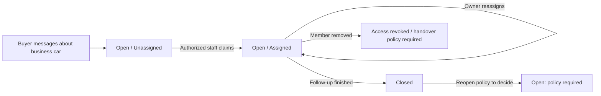

# 38 — Dealer workspace and public showroom

> Proposed capability revision, 2026-10-14. Captures founder-agreed direction; not a shipped feature, sprint commitment or authority to enable it. Material ownership, shared enquiry and rollout decisions require a new ADR before implementation. [ADR-0027](../../adr/0027-mlp-beta-scope.md) remains authoritative for MLP deferral. Existing accepted ADRs are unchanged.

## Outcome and scope

A car-selling business manages its vehicle inventory and enquiries inside the same Carberk app. Buyers discover its cars among private listings and open a shareable public showroom. Dealer access is free, with no trial expiry, paid dealer tier or paid ranking. Optional diagnosis is a separately priced physical service, specified in [50](50-reports-tier.md).

The pilot serves identifiable car-selling businesses, including small showrooms. Broker eligibility remains open. Vehicle search contains specific available cars; general showroom updates do not enter vehicle results. No separate dealer app, shared business login, social posting feed, CSV import, automated lead routing, reviews, multi-location operation or advanced sales CRM in this scope.

## Document ownership

| Concern | Owner |
|---|---|
| Dealer capabilities, inventory and showroom rules | This PRD |
| Personal sign-in and membership | [30 — Identity](30-identity.md), [ADR-0013](../../adr/0013-user-role-split.md) |
| Existing listing wizard and media/contact invariants | [32 — Listings](32-listings.md), [create flow](../flows/61-create-listing.md) |
| Dealer journeys and external listing/showroom sharing | [67 — Dealer and sharing flow](../flows/67-dealer-workspace-and-sharing.md) |
| Conversation behavior and dealer extension boundary | [34 — Conversations](34-conversations.md) |
| Optional inspection and report audience | [50 — Diagnostic reports](50-reports-tier.md) |

## People, workspaces and permissions

Every staff member signs in personally with existing Sign-in Methods. Cabinet provides entry to the showroom workspace and back to personal use. The five main tabs remain Search, Favorites, Sell, Messages and Cabinet. Switching workspace changes the authorized business context; it does not sign in as the business or grant Marketplace Role admin.

| Action | Owner | Sales member | Public buyer |
|---|---|---|---|
| View public showroom and active cars | Yes | Yes | Yes, anonymously |
| Create/edit/publish/mark sold business cars | Yes | Yes | No |
| Read business enquiries and responder history | Yes | Yes, subject to membership | Own conversations only |
| Claim an unassigned enquiry and reply | Yes | Yes | No |
| Reassign responsibility | Yes | No | No |
| Change business details or membership | Yes | No | No |
| Access another person's personal inventory or private diagnostic report | No implied access | No implied access | No implied access |

Business onboarding is application or invitation followed by manual approval. Application is a request, not self-activation. Exact business evidence, platform recruitment channel, staff-invite delivery/redemption/expiry, last-owner protection, owner replacement and suspension rules must be decided before corresponding implementation. No actual invitation is sent by shaping work.

The public business identity indicator describes what was checked and when. It does not certify vehicle condition, guarantee the sale or purchase a ranking advantage. Exact evidence and public wording require approval; do not resurrect a generic paid PRO claim.

## Business inventory and publication

Business Listings belong to the Dealership, with the creating/changing User attributed. Staff removal does not delete inventory or transfer it to a personal seller. Personal Listings stay personal when a User joins a business. An existing personal Listing moves only through an explicit authorized transfer, with owner, contact, conversations and report association effects specified before enabling transfer. Transferring another member's personal Listing is unresolved.

Dealer publishing extends the existing seven-step wizard. It does not create a second wizard or change its minimum media, contact verification or draft recovery rules. Entry from business inventory fixes and displays the selected business. Ordinary Sell offers Personal or Showroom to an eligible member before starting the draft. Review clearly shows the publishing business and contact. A context change never silently moves an in-progress draft or its media to another owner.

Initial inventory states are Draft, Active, Sold and Archived. Preserve the underlying Listing lifecycle/moderation rules; these labels do not define new automatic republish transitions. Weekly availability review records the last confirmation without refreshing publication date or ranking. Automatic hiding of stale inventory remains open.

One public business contact number serves business Listings. The verification subject, delegate authority and removal/reverification behavior need explicit reconciliation with [ADR-0056](../../adr/0056-listing-contact-phones-are-verified.md), whose current proof belongs to a User. A plain business-number field is insufficient authorization. Business identity checking and listing-contact proof are separate.

## Shared enquiry handling

An enquiry about a business car belongs to the business, with the buyer and actual responding staff attributable. It enters Unassigned. A staff member claims it; the owner may reassign. Claim must be atomic so two staff do not both believe they own the next response. Open/Closed tracks follow-up separately from assignment.

Authorized staff see responsibility and reply history. Removing membership must revoke server and realtime access, stop future private notifications and preserve authored history. Reassignment of removed staff's work, reopening and handling existing buyer conversations on personal-to-business transfer remain open. The local prototype returns removed staff assignments to Unassigned; this is a proposal, not an approved policy.

Public showroom Message must identify a car or use an explicitly designed business-enquiry target. Current Conversations require a Listing. For this pilot, guide the buyer to an available car before composing; a generic listing-less conversation requires a separate contract decision. Existing personal conversations keep their behavior.

## Discovery and public showroom

Mixed vehicle results reuse current card shape, photo/price/details/actions and spacing. Replace hardcoded Private seller with truthful business identity only for business-owned cars. Business name opens the showroom. Add an explicit seller-type filter without changing other filters or their draft/apply behavior. Dealer identity and inspection availability do not automatically boost ranking. Ranking diversity rules remain open.

The showroom is a page composed from Identity and Listings, not a new bounded context. Display order:

1. Compact business name/logo, checked identity information when available, city and contact/address actions.
2. Active inventory using the same vehicle cards, with pagination and scoped filtering as useful.
3. Description, hours and service details.

Call and external directions follow the existing contact/map decisions. Do not introduce a new map provider or exact-location collection. Reading needs no sign-in. Saving or messaging uses existing authentication with deferred-action replay. Do not force authentication just to browse or open a shared link.

No active cars is an honest empty state. Sold cars do not masquerade as inventory. Suspended/unavailable business pages follow an approved moderation visibility policy; they never expose private staff data. Response-time statistics, tenure claims and sales totals require real data definitions before display. Initial workspace counts are active cars, drafts, availability reviews due and unanswered enquiries. Phone taps are not completed calls; sold marks are not verified transactions.

## Sharing and design fit

Both individual Listing sharing and showroom sharing are required in this scope. Use the system share sheet and Copy link with public mobile-friendly browser fallback. Sold Listing links remain clearly sold, offer no new enquiry and may point to available showroom cars; removed/moderated content stays hidden. The live page is authoritative because external previews can be cached. Full link states are owned by [flow 67](../flows/67-dealer-workspace-and-sharing.md).

Use existing [design tokens](../ui/71-design-tokens.md), [component library](../ui/78-component-library.md), [accessibility rules](../ui/77-accessibility.md), current Cabinet grouped rows and native detail/back navigation. Do not copy the local HTML prototype's desktop shell into the mobile app. A phone-sized prototype demonstrates the journeys; approved screen designs must be reconciled before native implementation. Maintain RU/TK/EN chrome, light/dark themes, keyboard/safe-area behavior, text scaling and slow-network recovery.

## Current evidence and required changes

At source baseline `cf452fd3`, [schema](../../../packages/db/prisma/schema.prisma) has Dealership/DealershipMember scaffolding but Listing ownership and draft ownership are User-based; membership currently makes `userId` unique. Business Listings and shared dealer Conversations are not implemented. Multiple-business membership must not be inferred from the workspace concept. Decide cardinality before schema changes.

Existing [wizard](../../../apps/mobile/src/listings/wizard/wizardMachine.ts), [autosave](../../../apps/mobile/src/listings/wizard/useWizardAutosave.ts), upload queue and [tab layout](../../../apps/mobile/app/(tabs)/_layout.tsx) are integration anchors. Current source/tests establish behavior; this PRD establishes proposed target behavior. New ownership and authorization need migrations, ports and integration tests under the repository delivery workflow.

## Acceptance evidence before release

- Personal create/edit/publish/resume and upload-retry paths retain current behavior. Dealer creates through that same wizard, with business context on review and server ownership enforcement.
- Wrong/revoked membership cannot mutate inventory, read enquiries, fetch private evidence or continue through stale realtime subscriptions. Staff deletion does not cascade-delete business inventory.
- Concurrent claims have one winner; owner reassignment preserves responder attribution. Personal inbox and personal cars remain separate.
- Feed, detail and showroom agree on seller identity, lifecycle and available count. Seller-type filtering preserves existing search filters/sorts.
- Listing and showroom links work installed/uninstalled and signed in/out, including sold, removed, unknown and suspended states. Verify actual HTTPS association and browser previews.
- Native phone and browser checks cover current components, RU/TK/EN, text scaling, light/dark, keyboard, safe areas and slow data. A local HTML demo is not production evidence.

## Open decisions and formalization

Before execution: ownership/membership/deletion migrations; contact proof; invitation and last-owner recovery; removed-staff handover; moderation visibility; personal-to-business transfer; multi-business cardinality; link host/locales/association; pilot admission and success criteria. Diagnostic operational decisions are owned by [50](50-reports-tier.md). Scope does not authorize a sprint date or reopen MLP commitments.
