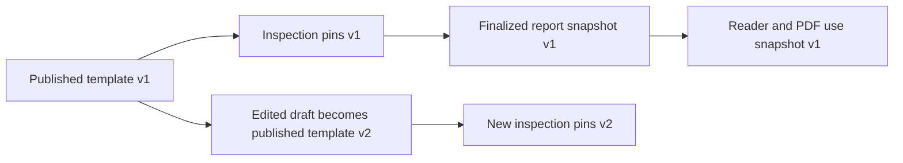
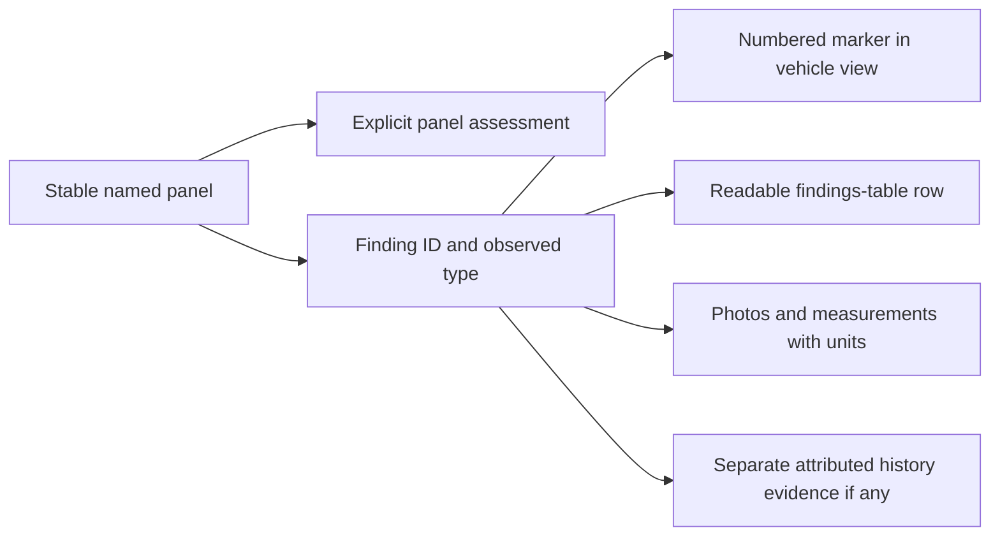
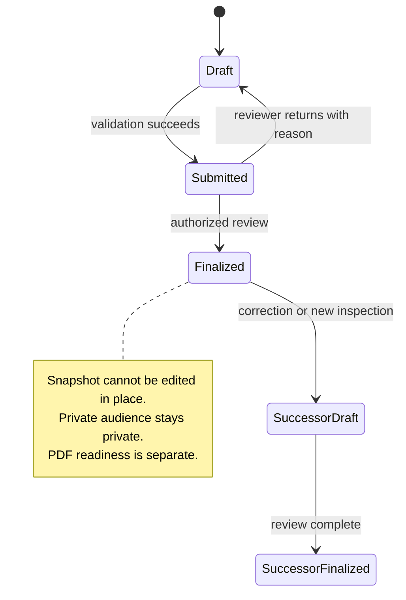

# 50 — Diagnostic inspections and reports

> Proposed revision. Founder direction captured 2026-10-14. This target specification is not implemented, scheduled, or authority to open a live service. Material changes require a new accepted ADR reconciling [ADR-0037](../../adr/0037-trust-inspection-competitive-wedge.md), [ADR-0057](../../adr/0057-defer-the-in-app-inspection-demand-signal.md) and the prior tier-based direction. Operational decisions below remain open.

## Outcome and scope

Carberk offers an optional vehicle inspection through one founder-operated center in Aşgabat, with one service plan. Personal and dealership vehicles use the same inspection standards. Ordinary listings can publish and function without an inspection. The existing listing wizard remains the publishing flow; service requests are an optional extension after publication, not an extra wizard gate.

Founder clarification on 2026-10-15 commits to a diagnostic scanner, paint-thickness meter and basic physical checks in the default plan. Mechanics must validate supported vehicles, scanner functions, measurement methods, calibration and the exact checklist. Equipment availability is a founder commitment, not evidence of installed/tested readiness. Test duration, service price, vehicle-history database access and safety certification are not established here.

A responsive worker portal records structured results and evidence. A customer reader and printable PDF present the same finalized report snapshot. Detailed journeys belong to [flow 66](../flows/66-diagnostic-inspection.md), PDF behavior to [feature 51](51-pdf-export.md), and service operations/readiness to the [inspection program](../business/inspection-program.md).

## Decision status and release boundary

Accepted founder direction includes a single center/plan, optional service, manual confirmation, cash payment at the center with no online payment, buyer requests for both individual and dealer Listings, configurable checks, worker authoring, printable reports and two report audiences. Authorized staff publish complete findings; sellers cannot rewrite or selectively suppress defects.

The following details are proposals pending agreement: vehicle identity matching, public VIN masking, exact staff capabilities/review separation, freshness and correction rules, retention, cancellation/refund terms, report transfer/relisting rules and private-to-public conversion. They must not acquire approved status merely because a prototype demonstrates them.

The legacy Gold/Silver/Bronze score bands and "Trusted by" badge are not requirements for this initial service proposal. Their replacement/deferment needs formal reconciliation with the vision and prior decisions. No automatic ranking boost is approved for diagnosis, dealership membership or Carberk-owned inventory. Existing ranking remains in force. A factual dated public-report entry and an optional filter can be designed without claiming a car is good or safe.

ADR-0037 commits to a manual pilot before the larger inspector operation. ADR-0057 removes inspection demand signals from the release. This proposal changes the target direction and requires a superseding/amending ADR before production execution. Software shaping and preparation can progress while the center is prepared. Public request entry stays unavailable until real service readiness is approved. Do not reactivate `InspectionInterest` or its coming-soon prompt as booking.

## Actors and audiences

The requesting customer, invoice payer, vehicle owner, Listing owner and report audience are distinct. The center records which person authorized physical access and which authority permits public publication.

| Audience | Intended access | Listing behavior |
|---|---|---|
| Buyer-private | Commissioning buyer and specifically authorized center staff | No public attachment, report indicator or disclosure that the private inspection exists |
| Seller/dealer public listing report | Public readership after recorded publication authorization, identity matching and staff publication | Complete public findings, limits and corrections linked from the eligible Listing |

Buyer-private is a private purchase decision service, not covert access to another person's vehicle. Vehicle-owner authorization to bring/inspect the car still applies. Paying for a report does not grant another person's identity documents or publication rights.

A later interested buyer does not receive a previous buyer's private report through Listing ownership, dealership membership, knowing a report ID or being a new payer. Public report readership is free. Private-to-public conversion and cross-buyer reuse are outside the initial proposed flow until separately agreed. A seller can arrange a public listing inspection. Reusing an older snapshot must never be described as a fresh inspection.

## Request transparency, authorization and vehicle data

Initial service scope includes a buyer request entry on eligible individual and dealer Listing detail screens once the real center is ready. It creates an inspection request, not a demand-interest record or automatically confirmed appointment. Buying the car and commissioning an inspection remain separate decisions.

Before confirmation, show the published checklist and plain-language descriptions of scanner diagnostics, paint-thickness measurements and physical checks, supported vehicles, limitations and unperformed scope, center location, manual appointment process, cash price/payment timing, report audience and an illustrative report. Do not imply scanner results establish complete mechanical condition or paint measurements prove accident history. Record the terms/checklist version accepted for the request; pin the actual inspection template when work starts and disclose material changes before proceeding.

Record physical-access authorization separately from public-report publication authorization and the customer's service terms. For a public report, the authorized seller/dealer signs before inspection that the complete findings may be published, including unfavorable findings. There is no favorable-results-only publication choice after seeing the results. A factual dispute uses the correction/dispute process. Legal wording, signature evidence, authority verification and withdrawal consequences need approval before use. Buyer-private inspections do not acquire publication authorization from this signature policy.

The founder also wants Carberk to collect and retain vehicle inspection data. Disclose the purposes, collected vehicle identifiers/results/measurements/photos, access and retention rules in the service terms. This direction does not establish an unlimited legal right, perpetual retention or public ownership-history database. Keep report access separate from internal data custody; no private buyer findings may become public or available to another buyer merely because Carberk retains them. Retention periods, lawful basis, deletion/correction handling and any later secondary use remain policy decisions.

Clarification is pending on the founder's phrase that buyers can agree or deny: the recommended interpretation is informed acceptance or decline before work, with the seller/dealer separately accepting or declining vehicle access. It must not become a buyer or seller veto over unfavorable finalized findings. Exact cancellation/payment consequences remain open.

## Staff access proposal

Each staff member signs in personally. Proposed capabilities are technician, reviewer and template manager. Technician works assigned inspections; reviewer returns or finalizes reports; template manager publishes checklist versions. Whether one person may review their own work is an unresolved operating rule.

Every read/write checks current capability, assignment and report audience on the server. A role switch in a prototype is not authorization. Removal of a staff capability prevents further access, including stale sessions and evidence URLs. General dealership staff have no access to private buyer reports about business inventory.

Existing `apps/admin` authorization requires an administrator with TOTP elevation. It does not establish a suitable worker authorization model. Scoped worker layout/API gates and their elevation policy require design before implementation. Content moderation reports remain separate from diagnostic Inspection Reports.

## Templates and recorded scope

A service plan references a published checklist template version. Check titles, descriptions, applicability and evidence instructions can be revised without changing historical results. Started inspections pin their template; finalized reports retain their exact template and results snapshot.

Proposed assessment values are Normal, Note, Fault, Not checked and Not applicable. Nothing defaults to Normal. Notes/faults need an explanation and required evidence; skipped checks explain why. Not applicable and Not checked do not count as passed. Unknown history is an uncertainty, not proof of a clean car. Finalization validation must not average a serious fault into a reassuring overall score.

Mechanical check counts and scoring are not fixed here. The historical [pilot rubric](../business/inspection-rubric-v1.md), mechanic capability worksheet and body worksheet are review inputs with different purposes, not competing approved templates.

## Body map and evidence

Use original or licensed vehicle drawings informed by [first-party report research](../../research/2026-10-14-carberk-inspection-report-patterns.md). Front, rear, left, right and top views show named panels with clear vehicle-oriented left/right labels. Body-style support and a text panel list provide a fallback when a drawing does not fit.

The worker selects a panel and records one or more findings. Every finding has a stable ID and panel ID; optional map coordinates supplement them. A marker is not the sole stored record. The same finding ID connects map, findings table, photographs, reader and PDF.

Record these as different facts:

- Current observed condition, such as scratch, dent, crack or corrosion.
- Evidence of repaint, replacement or repair, with measurement/method and uncertainty where applicable.
- Confirmed accident history only when an identified supporting source establishes it. Seller statements remain attributed statements.

Repaint alone does not prove an accident. Original paint does not prove absence of damage. Plastic is a material, not a pass result. Do not import another provider's severity codes or thresholds without mechanic approval.

A panel with no recorded assessment remains unassessed. An explicitly assessed panel may have zero findings; absence of a damage marker alone never establishes its assessment. Color can assist navigation, but labels, codes and marker numbers carry the meaning in monochrome. A complete textual equivalent supports small screens and assistive technology. Provide overview/close-up evidence where the approved template requires it. Mechanical findings remain report sections; a body map does not replace them.

## Separate lifecycles

A service request is not an appointment confirmation. Proposed service-order states distinguish requested, manually confirmed, in progress, completed and cancelled. No-show, incomplete inspection and payment handling need final policy. Order status is separate from report status and public visibility.

The proposed correction process creates a linked successor, records reason and author, and preserves history under its original audience. Reinspection records a new physical inspection date/mileage; an editorial correction does not. How earlier versions, withdrawals and disputes appear to each audience remains to agree. Do not silently overwrite a downloaded PDF.

## Vehicle and Listing association proposal

Record inspected vehicle identity, odometer, date/time, center, inspected scope and limitations. Store timestamps in UTC and show local time clearly. Do not require building a general vehicle registry to produce a report.

Public attachment requires an explicit vehicle match and publication authorization. Missing/nonstandard VIN needs manual handling, not a fabricated match. Proposed public display masks sensitive identity fields; exact masking and verification policy remain open. Private report authorization must not derive from current Listing ownership.

A report can exist before a Listing if the approved intake permits it. Price changes do not rewrite inspection facts. Material identity/condition changes, repairs, mileage changes, relisting or ownership transfer require an explicit association/freshness policy before implementation. No fixed validity period is promised. Every reader shows the inspection date and recorded mileage and explains its point-in-time scope.

## Failure and acceptance criteria

Future implementation must demonstrate:

- Personal and dealer listings publish without a report through the incumbent wizard, preserving drafts, upload ownership and recovery.
- Requested time is not shown as confirmed; duplicate/retried requests do not create conflicting appointments.
- Report IDs, Listing ownership and membership cannot bypass private access. Direct PDF/image URLs enforce equivalent audience policy; public caches and OG metadata reveal no private report existence or contents.
- Technicians cannot finalize without approved capability; stale access after removal is rejected. Draft/evidence access is scoped to the inspection.
- Missing/unchecked results cannot silently become normal; incomplete mandatory scope blocks finalization or uses an explicitly approved incomplete-report outcome.
- Template v2 does not change started/finalized v1 work. Finalized reports cannot mutate; correction/reinspection preserves traceable snapshots and audiences.
- Every map finding has a textual row and stable evidence references. Findings with no exact map position remain fully readable.
- Reader and PDF use the same finalized snapshot; failed generation does not present a downloadable artifact that does not exist.
- Public reports include all findings and limitations, excluding private customer information. Sellers cannot hide individual unfavorable panels.
- A buyer deciding against purchase does not expose their private report to the seller or buyer B.

## Implementation orientation

Current [Reports overview](../../../apps/api/src/modules/reports/CONTEXT.md) owns demand-interest capture only. [Listings](../../../apps/api/src/modules/listings/CONTEXT.md) still owns User-seller listings; [Identity](../../../apps/api/src/modules/identity/CONTEXT.md) owns personal identity and membership. [Admin](../../../apps/admin/CONTEXT.md) documents its existing authorization boundary. These links establish where to inspect code, not that the proposed service exists.

Domain rules stay framework-free. Cross-context identity/Listing access uses injected ports or events; Prisma remains behind infrastructure. Storage/rendering/provider choices require their own implementation decision and applicable ADR review.
