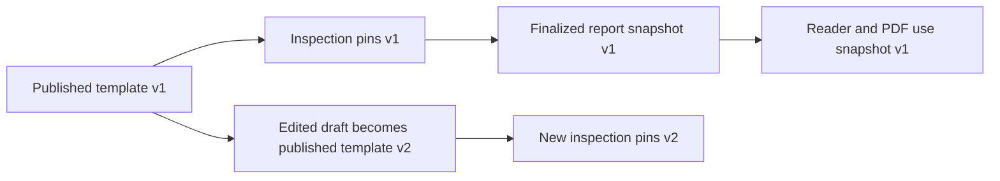
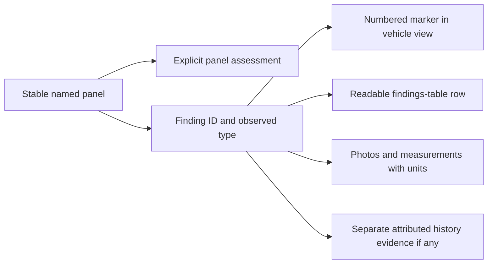
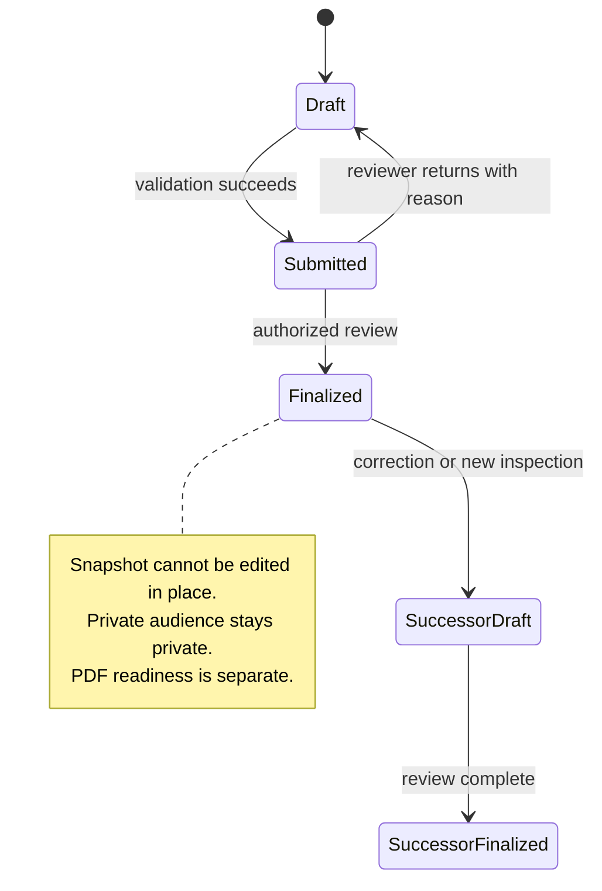

# 50 — Diagnostic inspections and reports

> Approved campaign target, 2026-10-14. Founder approved direction and final policy defaults; [ADR-0104](../../adr/0104-center-diagnostics-with-private-and-public-reports.md) formalizes material changes to [ADR-0037](../../adr/0037-trust-inspection-competitive-wedge.md), [ADR-0057](../../adr/0057-defer-the-in-app-inspection-demand-signal.md) and the prior tier-based direction. Human-owned center activation inputs remain separate from autonomous software delivery.

## Outcome and scope

Carberk offers an optional vehicle inspection through one founder-operated center in Aşgabat, with one service plan. Personal and dealership vehicles use the same inspection standards. Ordinary listings can publish and function without an inspection. The existing listing wizard remains the publishing flow; service requests are an optional extension after publication, not an extra wizard gate.

The proposed plan combines physical checks and computer diagnostics. Mechanics must validate what the prepared center can actually inspect. No equipment, test duration, service price, vehicle-history database access or safety certification is established by this specification.

A responsive worker portal records structured results and evidence. A customer reader and printable PDF present the same finalized report snapshot. Detailed journeys belong to [flow 66](../flows/66-diagnostic-inspection.md), PDF behavior to [feature 51](51-pdf-export.md), and service operations/readiness to the [inspection program](../business/inspection-program.md).

## Decision status and release boundary

Accepted founder direction includes a single center/plan, optional service, manual confirmation, payment at the center, configurable checks, worker authoring, printable reports and two report audiences. Authorized staff publish complete findings; sellers cannot rewrite or selectively suppress defects.

Final policy: assigned technicians author; a different qualified reviewer finalizes public reports; authorized private-report self-review is audited. Current scoped elevation and assignment are enforced server-side, never by full marketplace-admin grants. Physical access and separate public consent are recorded. Match observed identity and use documented manual handling for missing/nonstandard VIN, with masked public identifiers. Immutable linked corrections preserve original observations; material condition changes require a new inspection. Identity/ownership change suspends public association until revalidation. Reader may release while PDF is pending/failed/retrying. Withdrawal hides public access and badge while retaining authorized history under the rights-aware retention policy. Private-to-public conversion and private-report resale are excluded.

The legacy Gold/Silver/Bronze score bands and "Trusted by" badge are not requirements for this initial service proposal. ADR-0104 replaces them for this service; immutable earlier decisions retain their history. No automatic ranking boost is approved for diagnosis, dealership membership or Carberk-owned inventory. Existing ranking remains in force. A neutral public-report availability badge on Results cards and Listing detail opens complete dated findings without claiming the car is good or safe. No new inspection filter is included.

ADR-0037 commits to a manual pilot before the larger inspector operation. ADR-0057 removes inspection demand signals from the release. ADR-0104 changes the target direction while retaining real-service activation gates. Software shaping and preparation can progress while the center is prepared. Public request entry stays unavailable until real service readiness is approved. Do not reactivate `InspectionInterest` or its coming-soon prompt as booking.

## Actors and audiences

The requesting customer, invoice payer, vehicle owner, Listing owner and report audience are distinct. The center records which person authorized physical access and which authority permits public publication.

| Audience | Intended access | Listing behavior |
|---|---|---|
| Buyer-private | Commissioning buyer and specifically authorized center staff | No public attachment, report indicator or disclosure that the private inspection exists |
| Seller/dealer public listing report | Public readership after recorded publication authorization, identity matching and staff publication | Complete public findings, limits and corrections linked from the eligible Listing |

Buyer-private is a private purchase decision service, not covert access to another person's vehicle. Vehicle-owner authorization to bring/inspect the car still applies. Paying for a report does not grant another person's identity documents or publication rights.

A later interested buyer does not receive a previous buyer's private report through Listing ownership, dealership membership, knowing a report ID or being a new payer. Public report readership is free. Private-to-public conversion and cross-buyer reuse are outside the initial proposed flow until separately agreed. A seller can arrange a public listing inspection. Reusing an older snapshot must never be described as a fresh inspection.

## Staff access proposal

Each staff member signs in personally. Proposed capabilities are technician, reviewer and template manager. Technician works assigned inspections; reviewer returns or finalizes reports; template manager publishes checklist versions. Public reports require a different qualified reviewer. Private reports permit authorized self-review only with explicit audit.

Every read/write checks current capability, assignment and report audience on the server. A role switch in a prototype is not authorization. Removal of a staff capability prevents further access, including stale sessions and evidence URLs. General dealership staff have no access to private buyer reports about business inventory.

Existing `apps/admin` authorization requires an administrator with TOTP elevation. It does not establish a suitable worker authorization model. Scoped worker layout/API gates enforce least privilege and current elevation for release/withdrawal; mechanics receive no general marketplace-admin or analytics grants. Content moderation reports remain separate from diagnostic Inspection Reports.

## Templates and recorded scope

A service plan references a published checklist template version. Check titles, descriptions, applicability and evidence instructions can be revised without changing historical results. Started inspections pin their template; finalized reports retain their exact template and results snapshot.

Proposed assessment values are Normal, Note, Fault, Not checked and Not applicable. Nothing defaults to Normal. Notes/faults need an explanation and required evidence; skipped checks explain why. Not applicable and Not checked do not count as passed. Unknown history is an uncertainty, not proof of a clean car. Finalization validation must not average a serious fault into a reassuring overall score.

Mechanical check counts and scoring are not fixed here. The historical [pilot rubric](../business/inspection-rubric-v1.md), mechanic capability worksheet and body worksheet are review inputs with different purposes, not competing approved templates.

## Body map and evidence

Use original or licensed vehicle drawings informed by [first-party report research](https://otorapor.com/ornek-oto-ekspertiz-raporlari). Front, rear, left, right and top views show named panels with clear vehicle-oriented left/right labels. Body-style support and a text panel list provide a fallback when a drawing does not fit.

The worker selects a panel and records one or more findings. Every finding has a stable ID and panel ID; optional map coordinates supplement them. A marker is not the sole stored record. The same finding ID connects map, findings table, photographs, reader and PDF.

Record these as different facts:

- Current observed condition, such as scratch, dent, crack or corrosion.
- Evidence of repaint, replacement or repair, with measurement/method and uncertainty where applicable.
- Confirmed accident history only when an identified supporting source establishes it. Seller statements remain attributed statements.

Repaint alone does not prove an accident. Original paint does not prove absence of damage. Plastic is a material, not a pass result. Do not import another provider's severity codes or thresholds without mechanic approval.

A panel with no recorded assessment remains unassessed. An explicitly assessed panel may have zero findings; absence of a damage marker alone never establishes its assessment. Color can assist navigation, but labels, codes and marker numbers carry the meaning in monochrome. A complete textual equivalent supports small screens and assistive technology. Provide overview/close-up evidence where the approved template requires it. Mechanical findings remain report sections; a body map does not replace them.

## Separate lifecycles

A service request is not an appointment confirmation. Proposed service-order states distinguish requested, manually confirmed, in progress, completed and cancelled. No-show does not create a report. Service failures escalate to correction/reinspection at company cost or founder refund decision; actual payment/refund methods and customer terms are activation inputs. Order status is separate from report status and public visibility.

The correction process creates a linked successor, records reason and author, and preserves history under its original audience. Reinspection opens a new physically authorized order with its own date/mileage, pinned template, empty findings and new evidence; an editorial correction does not refresh observations. Withdrawal removes public access and available indicators without public fallback. Authorized history preserves prior snapshots and reasons; private history remains restricted to its original audience. Disputes cannot hide selected faults. Do not silently overwrite a downloaded PDF.

[ADR-0108](../../adr/0108-pair-bound-diagnostic-reinspection-continuity-proof.md) governs reinspection continuity from predecessor report A to new physical visit B. Capture immutable per-visit identity evidence and bind a single-use proof to the exact A report version/snapshot/identity hashes and B order/observation version/identity hash, audiences, commissioners and applicable public identity/ownership digests. Equal normalized observed VIN allows automatic comparison only for unchanged identity/ownership and consistent evidence. Manual/manual, either manual/VIN direction, justified corrected identity and changed public Listing, seller or commissioner require comparative attestation by a currently qualified reviewer independently assigned to both orders, distinct from B's linking technician. Record the original/corrected identity, explanation and provenance; unresolved mismatch or a different vehicle refuses, even with equal VIN text. Inadequate retained material leaves B unlinked. Private links require the same nonnull commissioner, with no common Listing required; mixed audiences and different private commissioners refuse. Public transfer requires current publisher authority, fresh consent and revalidated association.

Recheck current authority, issuer/session, reviewer qualification/assignments where applicable, locked versions/digests, erasure, predecessor eligibility and uniqueness before atomic audited proof consumption and linked draft creation. Changes to candidate, observation, identity, ownership, authorization or assignment invalidate unused proof; reverting values cannot revive it. Exact retries preserve the same binding and create no duplicate consumption or audit. Later predecessor changes or erasure do not retroactively break a valid surviving B or block its writes. Linking grants no old report/PDF/evidence access, reuse or inherited consent. Keep existing minimum disclosure: no draft cross-order successor id; released successor ids disclose only to their own current commissioner or while independently publicly available. Predecessor assignment alone discloses nothing.

## Vehicle and Listing association proposal

Record inspected vehicle identity, odometer, date/time, center, inspected scope and limitations. Store timestamps in UTC and show local time clearly. Do not require building a general vehicle registry to produce a report.

Public attachment requires an explicit vehicle match and publication authorization. Missing/nonstandard VIN uses documented manual review, not a fabricated match. Public identifiers are masked; original identity evidence stays restricted to authorized staff. Private report authorization must not derive from current Listing ownership.

A report can exist before a Listing if the approved intake permits it. Price changes do not rewrite inspection facts. Material condition changes/repairs require a new physical inspection. Identity/ownership changes suspend public association pending authorized revalidation. Relisting alone preserves observations and never refreshes their date/mileage; price edits do not invalidate identity. New observations record actual date/mileage. No fixed validity period is promised. Every reader shows the inspection date and recorded mileage and explains its point-in-time scope.

## Failure and acceptance criteria

Future implementation must demonstrate:

- Personal and dealer listings publish without a report through the incumbent wizard, preserving drafts, upload ownership and recovery.
- Requested time is not shown as confirmed; duplicate/retried requests do not create conflicting appointments.
- Report IDs, Listing ownership and membership cannot bypass private access. Direct PDF/image URLs enforce equivalent audience policy; public caches and OG metadata reveal no private report existence or contents.
- Technicians cannot finalize without approved capability; stale access after removal is rejected. Draft/evidence access is scoped to the inspection.
- Missing/unchecked results cannot silently become normal; incomplete mandatory scope blocks finalization or uses an explicitly approved incomplete-report outcome.
- Template v2 does not change started/finalized v1 work. Finalized reports cannot mutate; correction/reinspection preserves traceable snapshots and audiences.
- Every map finding has a textual row and stable evidence references. Findings with no exact map position remain fully readable.
- Reader and PDF use the same finalized snapshot; failed generation does not present a downloadable artifact that does not exist.
- Public reports include all findings and limitations, excluding private customer information. Sellers cannot hide individual unfavorable panels.
- A buyer deciding against purchase does not expose their private report to the seller or buyer B.

## Implementation orientation

Current [Reports overview](../../../apps/api/src/modules/reports/CONTEXT.md) owns demand-interest capture only. [Listings](../../../apps/api/src/modules/listings/CONTEXT.md) still owns User-seller listings; [Identity](../../../apps/api/src/modules/identity/CONTEXT.md) owns personal identity and membership. [Admin](../../../apps/admin/CONTEXT.md) documents its existing authorization boundary. These links establish where to inspect code, not that the proposed service exists.

Domain rules stay framework-free. Cross-context identity/Listing access uses injected ports or events; Prisma remains behind infrastructure. Storage/rendering/provider choices require their own implementation decision and applicable ADR review.

## Final discovery and classified data policy

A neutral localized "Inspection report available" action appears on Results cards AND Listing detail only for an available authorized public report. It opens complete findings/date/mileage; no quality/pass guarantee, green approval checkmark or ranking boost. No private-report existence leaks. Withdrawn/unavailable associations invalidate badge eligibility, public reads and first-party caches.

Retain permitted useful vehicle/market observations and genuinely anonymized market insights indefinitely where rights allow, otherwise for the longest justified permitted period. Separate private reports/evidence, customer/contact/chat/payment linkage, provider terms and justified holds. No blanket service/inspection purge duration is approved. Before real collection/export, record provenance, purpose/rights, audience, identifiability, retention/deletion/hold rules and permitted reuse. Restricted per-visit identity evidence and pair-bound proof provenance follow this same purpose/rights/holds/erasure contract, with comparative material restricted to staff independently authorized on both orders. No lineage grants commissioner or public access to it. ADR-0108 adds no data rights, retention period or extended preservation: no fabricated backfill, old snapshot rewrite or blanket TTL. A VIN, pseudonym or hash is not anonymous; removing a name alone is insufficient. No raw customer sale, private inspection disclosure, data sales portal or changed telemetry retention. Account deletion removes/anonymizes personal linkage where required; legally justified scoped holds must be explicit and audited.

All staff/admin workspaces, customer readers and generated user-facing exports support TK/RU/EN. Approved technical translations preserve finding IDs, observations and measurements. Original provider documents are not silently translated.
