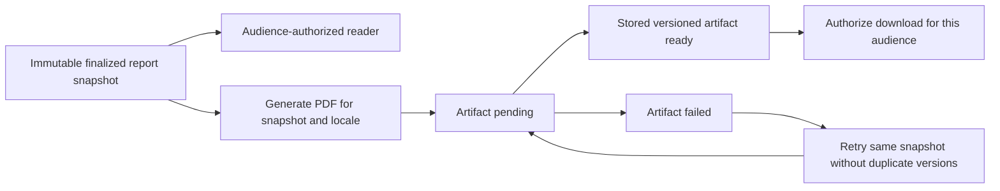

# 51 — Inspection report PDF output

> Proposed revision, founder direction captured 2026-10-14. Not implemented or scheduled. Subject to [feature 50](50-reports-tier.md)'s ADR reconciliation and operational decisions. The existing printable worksheets are mechanic-review artifacts, not issued customer reports.

## Output contract

Generate a stored, versioned PDF from the same immutable finalized snapshot used by the authorized customer reader. It records what staff inspected at a particular date/mileage, not a warranty, accident-history guarantee or universal validity period. Public and buyer-private reports use one structured inspection model with different access and redaction rules.

This specification owns PDF content, generation, delivery and parity. [Feature 50](50-reports-tier.md) owns report/audience policy; [flow 66](../flows/66-diagnostic-inspection.md) owns journeys. No concrete renderer, storage vendor or generation SLA is newly selected here. The old Puppeteer/MinIO design was a target, not evidence of an implemented pipeline; implementation must reconcile renderer/storage choice through the applicable decision process.

## Generation and versioning

The proposed production pipeline is server-side. A browser Print control is useful for a prototype but does not establish the issued artifact source of truth.

Track report ID/version, template version, locale, generation time and artifact identity. Retries for the same snapshot/locale must not create conflicting report revisions. PDF readiness is separate from report finalization. Do not show a successful download or send a ready notification before the artifact exists and is accessible to the intended recipient. The exact public-release sequencing while generation is pending is an implementation decision to approve explicitly.

A correction creates a linked new snapshot and artifact. A new inspection records a new physical observation date/mileage. Previous artifacts retain their original content and access policy. The current report reader shows authorized correction/supersession/withdrawal status. Already exported copies cannot be silently rewritten, revoked or guaranteed deleted.

## Document content

- Carberk identity, report identifier/version, template version, inspection center, date/time and recorded mileage.
- Vehicle details sufficient for the approved identity-matching policy, using audience-appropriate VIN/plate masking. No legal title or mileage-authenticity guarantee.
- Clear scope, incomplete/unchecked/not-applicable items, findings and buyer-relevant limitations. No unapproved Gold/Silver/Bronze badge or reassuring score.
- Original multi-view body map with orientation labels, explicit assessed/unchecked status and numbered finding references. Include the complete text findings table even if the illustration is unavailable.
- Current damage, observed repaint/replacement/repair and attributed confirmed history as separate facts. Include measurements with units/method where captured, uncertainty, evidence photo references and captions.
- Mechanical/computer-diagnostic sections and approved evidence; body drawings do not replace them.
- Authorized center/staff attribution under the agreed publication policy; customer/private internal notes stay excluded from the public artifact.
- Point-in-time limitations and a link/reference to the current authorized report record. Draft exports are visibly marked Draft and cannot resemble a finalized inspection.

The exact privacy fields, staff attribution, required photographs and final customer wording need operating approval. Exporting a report does not imply exporting identity documents, private contacts, booking conversations, payment details or internal reviewer notes.

## Audience and verification

| Artifact | Delivery | Verification behavior |
|---|---|---|
| Public listing report | Public approved copy after publication gates | Public current-report page shows full approved findings and revision status without private intake data |
| Buyer-private report | Authenticated/otherwise explicitly authorized delivery under approved policy | Verification retains the same private audience; knowing an ID, URL or QR is insufficient |
| Draft preview | Authorized staff only, clearly marked | No public discovery or public verification metadata |

A private PDF QR/link must not point to a public Listing/report page that discloses the inspection. Public verification should refer to the report identity rather than depend only on a Listing that may be sold/removed. The exact public-report behavior after Listing removal, correction or consent dispute remains to agree.

Do not put private reports in public buckets, permanent bearer URLs, OG metadata, analytics payloads or shared caches. Evidence image access obeys the report audience too. Delivery design must prevent authorization leakage through redirects, CDN caching and stale staff permissions. Recipients can retain downloaded copies; customer copy must explain that limit without promising revocation.

## Layout, languages and print

Use the supported product locales with approved technical translations. Store artifact locale explicitly; do not silently infer the customer's language from vehicle description. A translated artifact must retain the same finding IDs, measurements and uncertainty as its source snapshot. Do not promise automatic technical translation.

Embed licensed fonts covering Turkmen, Cyrillic and Latin glyphs. Test actual Turkmen characters such as ä, ç, ň, ö, ş, ü, ý, ž and their uppercase forms. Numbered markers and textual codes must work in monochrome, with sufficient contrast and no color-only meaning.

Use readable A4 pages, repeated table headers, sensible breaks, clear footer/page numbers and uncut photos/legends. Keep finding row and evidence reference association clear across page boundaries. Sparse/long notes, many findings, zero photos and alternate body styles must not clip or overlap. A drawing without a findings table is insufficient.

## Acceptance criteria

- Reader and exported PDF show identical finalized check outcomes, map/finding IDs, measurements, scope limits, dates/mileage and correction status for the same snapshot/locale.
- Private report/PDF/photo access is denied to unrelated buyers, vehicle sellers, dealership members and removed staff without separate authority. No private existence/content leaks through public routes or metadata.
- Public exports include all published findings and exclude private customer information/internal notes. Sellers cannot generate a favorable-only artifact.
- Generation failure/retry preserves the report snapshot, gives an accurate state and produces one consistent artifact identity per snapshot/locale policy.
- Template edits and later Listing edits never rewrite old artifacts. Corrections/reinspection create traceable new snapshots and current-record links.
- Every marker has a readable text equivalent; print remains understandable in grayscale and at normal A4 scale.
- Render and inspect every page of representative short/long reports in each supported language, including body diagrams, glyphs, evidence, page breaks and draft labels.
- Verify real production authorization and storage delivery, not only mocked reader responses or prototype role switching.

Current [Reports](../../../apps/api/src/modules/reports/CONTEXT.md) implements no PDF pipeline. Existing Listing media provenance rules do not automatically authorize diagnostic evidence uploads; its scoped adoption/delivery boundary must be designed separately.

## Visual review sample

The [four-page Turkmen sample report](../../../output/pdf/carberk-diagnostika-hasabat-nusgasy-tk.pdf) demonstrates a priority-first summary, original five-view car diagram with numbered findings, an equivalent results list and finding explanations. It is filled with fictional data and explicitly labelled as a demonstration on every page. Its ten example checks, measurements and observations are not the service's approved scope or real inspection results. Real evidence photos, validated terminology and authorized report verification must be supplied by the implemented service. This sample is separate from the mechanic capability checklist and blank body-map worksheet.
