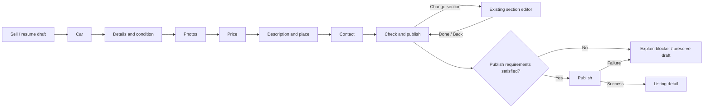

# 61 — Create Listing flow

## Summary and authority

A seller opens Sell, completes the current seven-step wizard and publishes a car. This flow is reconciled on 2026-10-14 with [32 — Listings](../features/32-listings.md), [wizard contracts](../../../packages/contracts/src/schemas/wizard.ts) and the [mobile wizard machine](../../../apps/mobile/src/listings/wizard/wizardMachine.ts). It replaces this flow's stale VIN-first ordering and one-photo minimum. It does not redesign the shipped wizard.

The proposed dealer extension below is separate from the current personal flow and needs material-decision ADR formalization. Detailed fields/limits belong to Feature 32 and contracts, not a second wizard specification here.

## Entry

The existing Sell tab offers Continue for the latest draft and New listing when appropriate. My listings exposes drafts. An existing Listing opens the edit path with published vehicle identity locked under the existing edit rules. Sell-from-Garage and VIN decoding are not introduced.

## Current seven steps

| Step | Seller action | Existing requirement to preserve |
|---|---|---|
| 1. Car | Select brand, model, optional generation, year; optionally enter VIN | Vehicle first. Optional format-checked VIN within Car; no separate VIN step, decoder or OCR promise |
| 2. Details and condition | Enter mileage/specs and seller condition disclosure | Used mileage and damaged disclosure follow the existing contracts; new-car damaged policy stays intact |
| 3. Photos | Pick camera/library photos and arrange cover/order | Three picked photos to continue; max 20. Uploads run while later steps are filled. Publish needs at least three attached and no unresolved upload failures/in-progress items |
| 4. Price | Enter full asking amount, currency and optional seller terms | Currency change clears amount; missing required FX blocks publish. No financing promise |
| 5. Description and place | Write description and select where the car is physically available | Required description and city/region; optional area. No GPS requirement, home-address request or forced translation |
| 6. Contact | Select/verify Listing contact and allowed contact methods | Verified Contact Phone is distinct from Sign-in Methods. Email-only sellers verify here without adding account phone. At least one permitted contact method |
| 7. Check and publish | Review all sections, correct a section, publish | Review links use the existing correction/Done return. Recheck validation, phone proof and upload readiness |

Back/Continue and corrections preserve entered data through the existing reducer, autosave and staged-media recovery. Closing the create wizard saves pending changes and returns to Sell. A newly created untouched draft is automatically deleted on close; if that deletion fails, it remains available in My listings. A failed save asks whether to retry, leave with the last saved draft, or keep editing. The wizard has no discard menu; confirmed Delete draft is available in My listings. Do not add arbitrary step jumps or change saved payload compatibility as a side effect of dealer work.

## Recovery and publication

- Photo failure offers retry/remove for that photo. Retry uses the current staged file and new authorized upload request as required; it does not restart the wizard or promise multipart byte resume.
- A failed autosave shows recovery without losing the currently entered form. Do not promise full offline server persistence.
- Background/kill recovery uses the existing draft and compressed-file staging behavior. Restored media must reconcile against server ownership and readiness.
- Contact verification expiry/error keeps Contact recoverable with existing SMS budgets. Contact proof never creates a Sign-in Method.
- Publish failure preserves the draft, explains the blocker and supports retry. Do not display a successful listing or clear staged files until success is confirmed.
- Successful publish follows the current detail/navigation behavior. No inspection-interest sheet is re-enabled under this flow; [ADR-0057](../../adr/0057-defer-the-in-app-inspection-demand-signal.md) remains effective.

## Proposed dealer extension, 2026-10-14

[38 — Dealer workspace](../features/38-showroom.md) owns business rules; [flow 67](67-dealer-workspace-and-sharing.md#journey-2-create-and-publish-a-dealer-car) owns the dealer journey.

A member entering from ordinary Sell explicitly chooses Personal or Showroom before starting. Inventory → Add car fixes the business context and shows it. Both entries open **this same wizard**. Review states which business will own the Listing and which verified public contact it uses. Neither an app workspace switch nor membership change silently transfers a draft or its media.

The server rechecks business membership, ownership, media authorization and contact authority on save/publish/edit. Losing membership fails with a recoverable access explanation, preserves business work for authorized members and never falls back to publishing personally. Exact draft access after removal and ownership transfer must be agreed before implementation.

Diagnostic inspection is optional after ordinary publication through listing management when the real center service is ready. The car goes to a center, initially the own Aşgabat center. No diagnostic booking, result or payment is a prerequisite for publishing. Private buyer requests use [flow 66](66-diagnostic-inspection.md), outside this wizard.

## Evidence before changing the wizard

Exercise existing personal create/edit, contact verification, Review correction, autosave, process restart/media recovery and upload/publish failure paths. Then exercise business context persistence, revoked-member refusal and business Review identity with the same production wizard. Native rendered verification must show existing tokens/components, keyboard handling, safe areas and RU/TK/EN. A throwaway HTML demo is not regression evidence.

## References

- [32 — Listings](../features/32-listings.md)
- [31 — Catalog](../features/31-catalog.md)
- [38 — Dealer workspace](../features/38-showroom.md)
- [50 — Diagnostic reports](../features/50-reports-tier.md)
- [ADR-0008 — Media](../../adr/0008-media.md)
- [ADR-0052 — Seller condition disclosure](../../adr/0052-seller-condition-disclosure-is-damaged-plus-known-issues.md)
- [ADR-0053 — Deferred VIN decoding](../../adr/0053-defer-vin-decoding-until-a-real-decoder-exists.md)
- [ADR-0056 — Verified Listing contact](../../adr/0056-listing-contact-phones-are-verified.md)
- [ADR-0080 — New-car damaged policy](../../adr/0080-a-new-car-skips-the-damaged-question.md)
