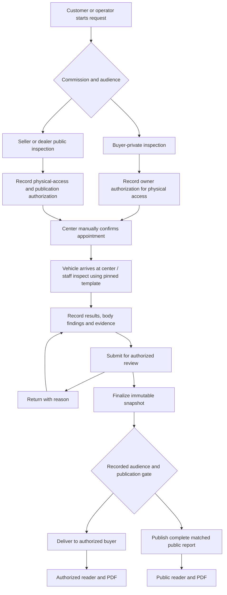
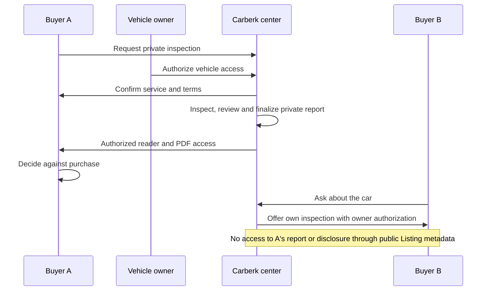

# 66 — Diagnostic inspection journeys

> Proposed revision, 2026-10-14 founder direction. Not implemented or scheduled. [Feature 50](../features/50-reports-tier.md) owns capability, privacy and report invariants. Its new-ADR and operational gates apply here. These flows do not reopen a live coming-soon interest prompt.

## One service, two audiences

Personal and dealer cars can use one center and one validated plan in Aşgabat. The commissioner chooses a private buyer inspection or a seller/dealer public listing inspection. This choice never removes the vehicle owner's physical-access authorization. The service price/duration are not yet defined. [The program](../business/inspection-program.md) owns operations; [feature 51](../features/51-pdf-export.md) owns output delivery.

Audience is recorded during intake. It must not change because a worker clicks Finalize or a seller claims the Listing. Exact consent evidence, approved role separation and publication transaction remain to settle.

## Seller or dealership journey

1. Publish/manage the car through the existing Carberk listing wizard. A report is optional; the same publishing flow serves personal and business contexts.
2. Request the real available inspection service through the approved listing-management/dealer-inventory placement. Before the center is ready, this entry does not advertise an unavailable service.
3. See plan scope, limitations, price and proposed time. The center manually confirms the appointment. Request confirmation is not a confirmed booking.
4. At the center, staff match the vehicle, record mileage and access/publication authorization, and explain any scope limits. For public reports, the authorized seller/dealer signs before inspection that complete findings may be published even when unfavorable. Pay cash at the center under the agreed terms.
5. Technician fills the pinned checklist. For body findings, choose view and named panel, add current-damage and repair-evidence observations separately, and link notes/measurements/photos.
6. Reviewer checks completeness and audience. Return incomplete work with a reason or finalize the complete snapshot under the agreed staff policy.
7. Generate the public output from that snapshot. Attach only after explicit vehicle matching and publication gates. Public readers see inspection date/mileage, all findings, skipped scope and correction status.
8. The seller cannot rewrite findings or hide only defects. Disputes follow a recorded correction process; repairs that warrant reinspection produce a new physical observation record.

The report entry adds to the existing Listing detail design. It does not replace seller condition disclosure, public showroom identity, or contact actions.

## Buyer-private journey and buyer A/B example

Initial launch includes buyer requests from both individual and dealer Listing detail. Before submitting, the buyer sees the published checks and methods, limitations, illustrative report, center location, cash price/payment timing, manual confirmation process and private audience. A request does not confirm a booking or authorize access to the vehicle. Record seller/dealer physical-access authorization separately. Decline/cancellation timing requires the policy clarification in feature 50.

Buyer A can commission an inspection to decide whether to buy. The seller authorizes physical inspection, but does not receive private-report access merely by owning the vehicle or Listing. Staff explain the agreed audience before the appointment.

A's decision against buying does not turn the report into a public Listing asset. B cannot buy access to A's private report through the initial proposed flow. B may request their own service. The seller may arrange a public inspection that every buyer reads free. Refund rules are a separate operational decision, not a consequence encoded by this diagram.

Private-to-public conversion, private report delegation and reusing another commissioner's snapshot are deferred until consent, price and freshness rules are agreed. A screenshot or downloaded PDF may be forwarded by its recipient; Carberk cannot promise revocation of copies already exported. The controlled service must enforce access to its own reader, PDFs and evidence.

## Worker body finding interaction

```mermaid
flowchart LR
  View[Choose vehicle view] --> Panel[Choose stable named panel]
  Panel --> Assessment[Explicitly assess or mark unchecked]
  Assessment --> Findings[Add zero or more numbered findings]
  Findings --> Type[Current damage or repair evidence]
  Type --> Notes[Notes, uncertainty and measurements]
  Notes --> Photo[Attach approved evidence photos]
  Photo --> ReviewList[Review map and equivalent findings list]
  ReviewList --> Snapshot[Final snapshot feeds reader and PDF]
```

An untouched panel is unassessed. The worker must not interpret an empty drawing as original paint or damage-free. Current scratches/dents, observed repaint/replacement and supported accident history are distinct. On a small screen, the panel list remains usable without precise diagram tapping. The actual drawing uses original vehicle views, text labels and a monochrome-readable legend.

## Failure and recovery examples

| Event | Required target behavior |
|---|---|
| Vehicle unavailable or appointment not confirmed | Clearly distinguish pending request from confirmed service; apply the agreed cancellation policy |
| Vehicle identity does not match Listing | Prevent public association pending authorized resolution |
| Check cannot be performed | Record Not checked and reason; never fabricate a pass |
| Upload fails | Preserve draft and finding IDs; retry without losing notes or attaching another inspection's evidence |
| Membership/worker capability removed | Deny subsequent protected actions on the server; preserve business/inspection records under the agreed retention policy |
| Reviewer returns report | Show reason and resume the same pinned-template draft |
| PDF generation fails | Show accurate artifact state and retry; finalized report data remains unchanged |
| Seller dislikes a finding | No per-finding deletion or favorable-only public copy; use correction/dispute route |
| Later correction or reinspection | Link new snapshot and show current status; never label old measurements as new |
| Unauthorized user guesses private report/media URL | Deny access without leaking private contents or public metadata |

Detailed correction visibility, vehicle-owner consent withdrawal, no-show/refund, retention, review separation, freshness and report association after transfer are still decision points in feature 50. Flow approval must not silently settle them.

## Evidence expected before launch

Exercise personal and dealer publishing without inspection; private A/public seller paths; unauthorized buyer B/dealer/staff access; evidence URL protection; template revision and correction history; body-map/list equivalence; failed PDF generation; all supported reader/PDF languages. Real center validation and operating approval are separate from passing software tests.
