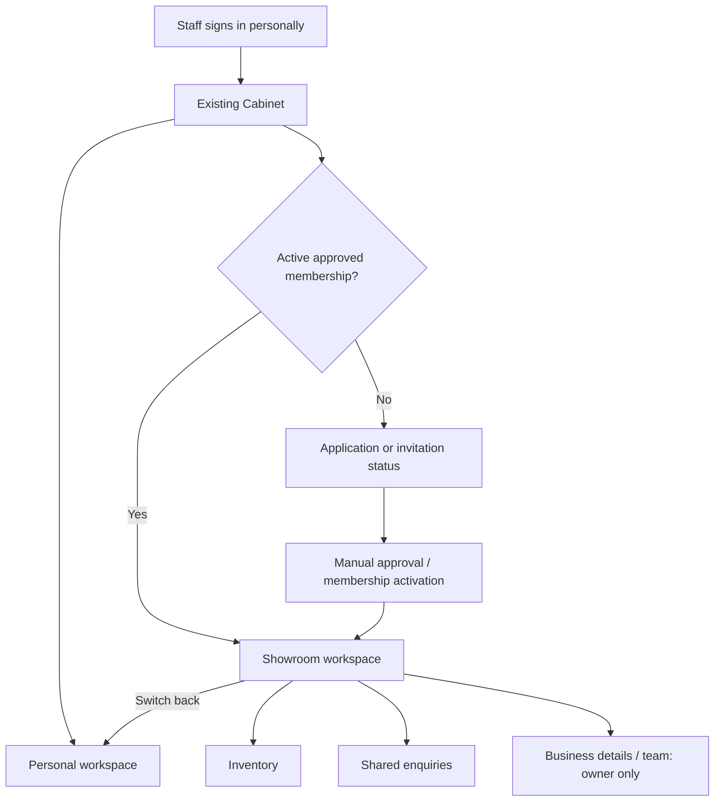
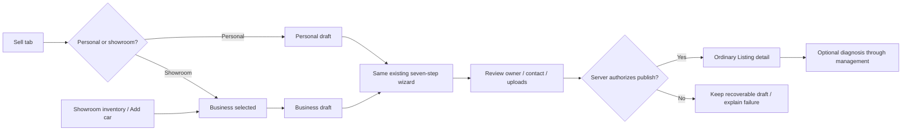
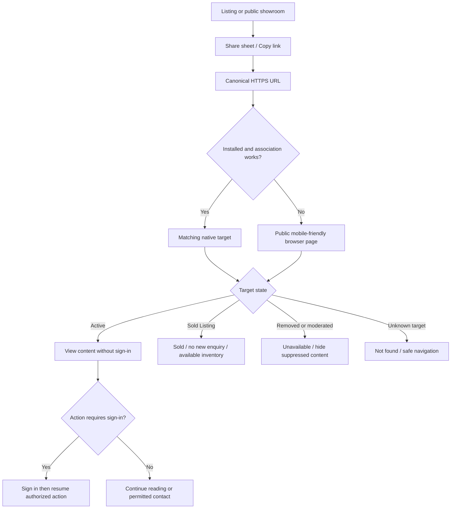

# 67 — Dealer workspace and external sharing

> Proposed journey revision, 2026-10-14. Target behavior under [38 — Dealer workspace and showroom](../features/38-showroom.md). Not implemented or scheduled; material decisions require ADR formalization. Does not alter locked sprint history.

## Journey 1: personal login to business work

Application/invitation does not grant access until server-confirmed approval and membership. Wrong-account, revoked, expired, duplicate and already-joined invitation paths require a concrete design before onboarding implementation. Staff sign-in and business contact are distinct identities.

Workspace selection is visible. Users keep personal drafts, personal conversations and settings; entering a showroom does not transfer or expose them. Staff removed while a business screen is open receives an access-denied recovery that preserves already-saved business work for remaining authorized members. The exact assignment handover policy is still open.

## Journey 2: create and publish a dealer car

1. Dealer workspace → Inventory → Add car. The selected business is explicit.
2. Open the existing Listing wizard. Use its current vehicle, condition, photos, price, description/place, verified contact and review steps, not a parallel dealer form.
3. Save/resume through the same draft machinery, extended with authorized ownership context. Upload retry and background/kill recovery remain intact.
4. Review shows business seller identity, location and public contact. Recheck membership and contact authority on publish.
5. Successful publication opens the ordinary Listing detail with the business seller block. The car appears in mixed search and showroom inventory.
6. Optional diagnosis is available through management after publication once the real service opens. Declining it never blocks the Listing.
7. Staff later mark the car sold. Public inventory, shared page and contact actions agree with that state.

Selecting another workspace does not implicitly change a draft owner. Existing personal-to-business transfer needs an explicit consent and association policy. Do not duplicate a car automatically to simulate transfer.

## Journey 3: buyer to shared enquiry

Buyer finds a specific car in mixed results, opens its ordinary detail and can tap the business name to browse the showroom. Message on the car creates the Listing-scoped business enquiry. A showroom contact route guides the buyer to a car; a generic business Conversation is not silently added.

Authorized staff see Unassigned, claim responsibility and reply as an attributed person representing the business. The owner can reassign. Open/Closed and assignment are separate fields. Marking sold disables new enquiries from public sold links; continuation of an existing conversation follows its lifecycle policy. See [34 — Conversations](../features/34-conversations.md).

## Journey 4: share a car or the whole showroom

External sharing of BOTH targets is required. Internal chat attachment sharing stays with [flow 63](63-share-listing-in-chat.md).

| Target | Live browser/native page | Proposed preview fields |
|---|---|---|
| Active Listing | Vehicle details, actual seller, permitted actions, public report if any | Vehicle title, price, cover photo, business name when applicable |
| Sold Listing | Explicit Sold; no new enquiry; related available inventory | Best-effort sold wording; cached previews may be old |
| Active showroom | Business identity, available cars, hours/contact | Business name/logo, city, description |
| Empty showroom | Business details and honest no-inventory state | Business identity without invented inventory |
| Removed/moderated/unknown | Unavailable/not found without suppressed photos or private metadata | Safe fallback; invalidate first-party caches where possible |
| Suspended business | Approved moderation visibility policy required | Never leak private details or suggest checked active status |

The live page determines current availability. We cannot guarantee refresh of a preview cached by another app. Do not leak a private diagnostic report or even its existence into Open Graph tags, crawler responses, sitemaps, public counts or listing badges.

Sign-in is not an installation or reading requirement. Opening in Carberk is optional when the browser fallback works. No new external sharing SDK is required merely for Copy link/system share. No PDF posters, QR marketing cards or deferred-install promise in this first scope.

The existing external Listing share controls remain hidden until the public Listing page and actual native associations work. Reopening scope is not proof those prerequisites are implemented. Choose canonical hostname, route locale rules, stable identifiers/slug redirects and HTTPS association files before wiring share controls. Route strings in old PRDs are examples, not a domain registration decision.

## Design and failure recovery

Use existing Listing cards, Cabinet rows, sheets, form controls and detail navigation. Preserve current tab structure; detail pages use normal Back and contact actions. Phone-sized designs must show end-to-end transitions, empty/denied/offline states and the actor's current workspace. Browser pages adapt the same content for small screens without an app-install wall.

A revoked membership between draft and publish is refused server-side. An unavailable Listing after sharing opens its current unavailable state. Failed Copy link/share shows retry without claiming success. A browser redirect must retain the target and approved locale, reject unsafe redirect destinations and avoid loops when app opening fails. Diagnostics are optional and have separate request/report access controls in [flow 66](66-diagnostic-inspection.md).

## Evidence before enabling

Verify on real native builds and browser fallback: both target types, installed/uninstalled, signed in/out, live lifecycle changes, unknown identifiers, moderation, locale handling, safe redirects, actual share payload and crawler metadata. Verify personal draft/upload regressions, revoked-member access, shared-inbox claims and public/private report isolation. Synthetic prototype transitions do not establish these capabilities.
