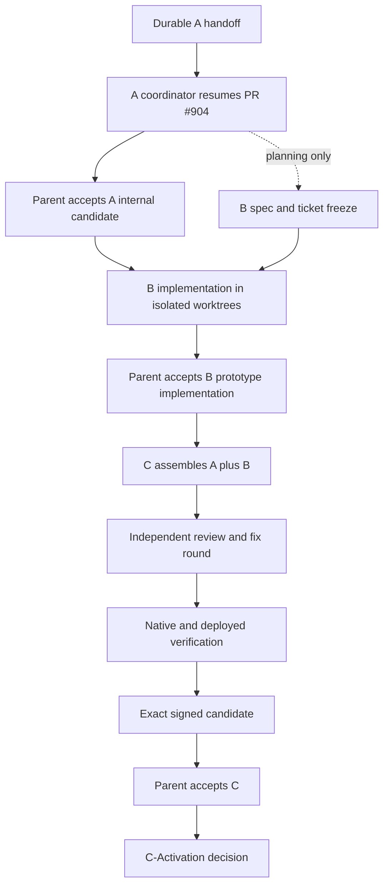

# Carberk release program charter

## Purpose

This charter governs milestones A, B and C for the Carberk release. The milestones are separate code streams with separate acceptance gates.

- **A** is the internal campaign candidate. It is the existing campaign execution in PR #904.
- **B** implements the frozen approved prototype in production code after A is accepted.
- **C** verifies the combined A and B candidate, including native, deployed and signing evidence.
- **C-Activation** is a later gate for real analytics and operations. C does not grant that approval.

The parent release thread owns program scope, dependencies, ticket-map authority, milestone exits and escalation. Only the parent may declare A, B or C complete. All coordinators and ticket workers use GPT Sol 6.1.

## Current authority

Milestone A stays on the existing candidate branch. The old coordinator is preserved as the historical source, and the fresh coordinator owns continuation from the durable handoff:

- Old thread: [A handoff source](t3-thread://v1/mcp:ac0bb7f1-e0a9-4ffa-b92b-fb4b4b91e833)
- Current thread: [A coordinator](t3-thread://v1/mcp:7bd149ca-47be-4af9-b4e0-446a4dfa0230)
- PR: [#904](https://github.com/Carberk/carberk/pull/904)
- Branch: `agent/release897-candidate-a-20261029`
- Original PR head before reconciliation: `agent/spec-897-campaign` at `023e6a5dcefbcd5d7e7c71bf4bba18f01a3d01ab`
- Durable handoff checkpoint: `52d901c50af1dde97ea22bda8efb1fdf21f169b1`
- A execution record: `docs/evidence/issue-897/milestone-a-execution-20261029.md` on the A branch

The [analytics audit thread](t3-thread://v1/mcp:db60eb22-7b75-40a7-8a09-5634011efe56) supplies evidence. It cannot authorize product implementation. Analytics responsibilities remain split as follows:

- A checks compatibility and safety boundaries.
- B implements the approved product measurement behavior.
- C verifies native and deployed behavior on the combined candidate.
- C-Activation separately approves diagnostics, alerts, collection rights, regional delivery, disclosure readiness and real collection.

B uses the frozen contract and decisions in `prototype-candidate-preview/CONTRACT.md`, `DECISIONS.md` and `VERIFICATION.md`. The freeze receipt must identify the approved prototype artifact's own immutable commit and digest. `f876ac97a3946649f87d986ff6eeb7ccd9f5bdc1` is its audited application source reference, not the approved prototype artifact SHA. The preview branch remains throwaway and is not merged into production.

## Dependency graph

Planning and spec freeze for B may proceed during A. B implementation requires both parent acceptance of A and the B freeze. This includes B code, migrations, shared contract changes and production tests. C cannot start until B acceptance.

## Ticket-map authority

The parent owns milestone scope. The A coordinator owns the [A Wayfinder ticket map at `46e82c394`](https://github.com/Carberk/carberk/blob/46e82c3942edeccfb66c81d7f7375b51d9f534fe/docs/evidence/issue-897/a-wayfinder-ticket-map-20261030.md), committed before dispatch. That map and the A execution record own A ticket dependencies; this charter does not maintain a second map. The coordinator records material changes for parent disposition and preserves live writers and checkpoints.

Parent oversight on 30 October 2026 verified PR #904 and both candidate refs at `dc8549ba21cd40704a377e7bdea3438e44b75ad7`, following ancestor-only fast-forward reconciliation. The [reconciliation receipt](https://github.com/Carberk/carberk/blob/dc8549ba21cd40704a377e7bdea3438e44b75ad7/docs/evidence/issue-897/a-10-pr-reconciliation-20261030.md) and [dispatch ledger](https://github.com/Carberk/carberk/blob/dc8549ba21cd40704a377e7bdea3438e44b75ad7/docs/evidence/issue-897/a-coordinator-dispatch-20261030.md) preserve provenance. A-01, A-02 and A-04 were running in isolated Sol 6.1 xhigh/priority worktrees. A-03 and A-05 awaited dependencies. No ticket or milestone pass is implied.

Review stays open while blocking findings remain, even when a fix list is accepted. The parent directed the coordinator to record actual worker HEADs, concrete verification commands and exclusive resources, and to keep evidence work read-only until a separate fix dispatch. Final acceptance uses the resulting assembled SHA and affected verification.

B's ticket map is created from the frozen prototype contract. At minimum it must separate shared contracts, mobile implementation, admin implementation, worker/PDF work and integration verification. A B worker may own only disjoint paths and resources. No B ticket may edit PR #904's branch.

C's map is verification work, not a second implementation queue. It contains one serialized assembly owner, one independent Standards and Spec review round, one fix round, native/device verification, deployed staging verification and exact-artifact signing evidence. Database resets, deployments, native builds and final acceptance are serialized by the C coordinator.

## Ticket contract

Every ticket body and every coordinator handoff must state all of the following:

1. **Owner and role.** Name the coordinator or worker and the review owner.
2. **Base SHA.** Give the immutable integration or prerequisite commit.
3. **Allowed paths and resources.** Include worktree, files, services, device and staging reservation where relevant.
4. **Dependencies.** List issue numbers and the exact accepted checkpoint required from each.
5. **Non-goals.** State the behavior, migration, activation or cleanup the ticket must not add.
6. **Tests.** Name repository checks and their configured commands, including the required TypeScript 6 and TypeScript 7 checks where applicable.
7. **Evidence.** Identify the receipt, log, screenshot, device result, deployment SHA or artifact digest that proves the claim.
8. **Pass/fail acceptance.** Write observable criterion-level outcomes. A missing receipt or unknown result fails the ticket.

Workers use isolated worktrees. Parallel work is allowed only for disjoint paths and resources. Shared contracts, assembly, migrations, database resets, deployments, native builds and final acceptance are serialized by the relevant coordinator. A checkpoint commit preserves work but does not establish acceptance.

## Milestone exits

### A exit

A passes only when the parent has an exact candidate SHA with the selected campaign behavior, applicable CI, required repository and native evidence, an independent review and completed fix round, and a clean recovery record. The candidate is internal. A does not invite users, activate paid services, submit to Play or activate real analytics.

### B exit

B passes only when production code implements the frozen approved prototype decisions, the B ticket map is complete, applicable checks and review/fixes are green, and the result is compatible with the accepted A candidate. Prototype screenshots or mocked paths cannot substitute for production evidence. B does not activate real analytics.

### C exit

C passes only when the parent can point to the combined A+B SHA, green applicable CI, independent review/fixes, native and deployed acceptance against that SHA, restored staging state and the exact signed Android artifact with its digest and package identity. A missing physical or deployed criterion remains open rather than being inferred from emulator or CI results.

### C-Activation exit

C-Activation is a separate decision after C. It requires the approved diagnostics and alert path, collection rights and disclosure readiness, regional delivery evidence, alert receipt, incident drill, retention/deletion behavior and the explicit decision to collect real user data. A signed candidate or a Google Play approval does not pass this gate.

## Safe A handoff

The replacement A coordinator may start only after the current A thread records a durable handoff and has no conflicting active writer. The handoff receipt must include:

- current clean pushed HEAD, branch, worktree and PR #904 head;
- every active child task or thread, its owned paths, resource reservation, status and expected return;
- completed evidence and the exact A gates that remain open;
- known blockers, failed checks and preserved recovery artifacts;
- one next action for the replacement coordinator;
- confirmation that no new child was dispatched during handoff.

The parent then verifies the receipt against the branch and PR, waits for the current coordinator and its children to settle, and only then launches a fresh A coordinator attached to the same worktree. The replacement resumes from the recorded SHA. It does not reset the branch, duplicate writers or reinterpret preserved evidence.

The old coordinator recorded the handoff at `52d901c50af1dde97ea22bda8efb1fdf21f169b1` with no active child writer. The fresh A coordinator attached to the same worktree and committed the Wayfinder map before dispatch. A remains open. B implementation, C verification and C-Activation remain gated.
