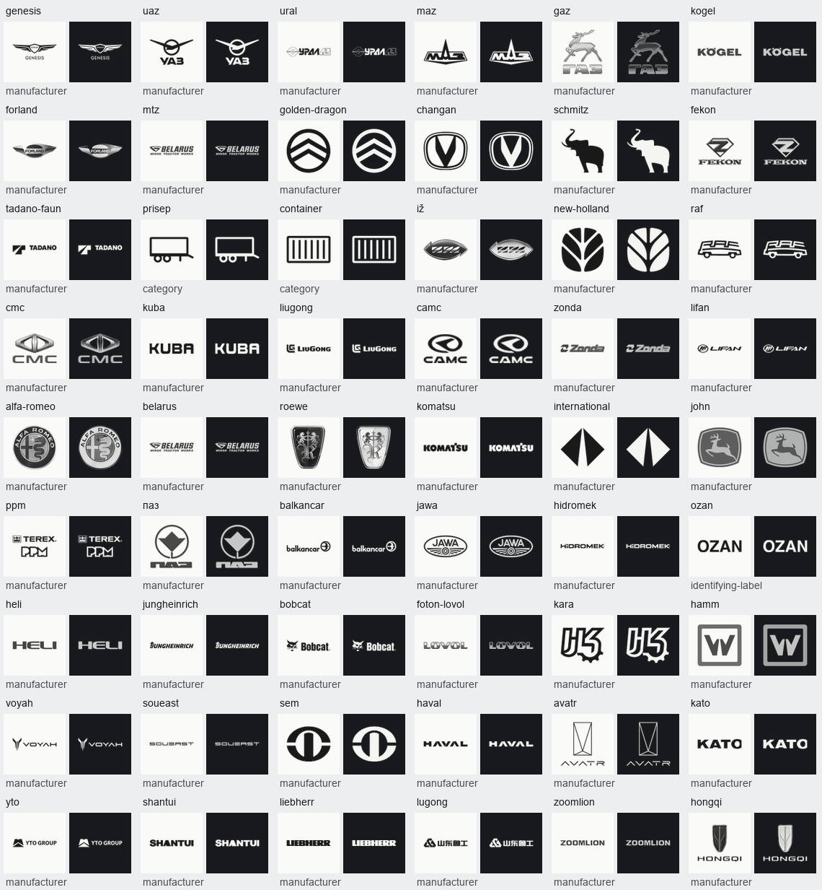

# Brand artwork coverage, 2026-10-11

Founder decision in the Codex chat: cover all 54 prior letter-fallback entries using correct identifying artwork and remove blanket source/category exclusions. Source integrity and brand identity remain required.

The selected set has 51 manufacturer artwork sources, two category illustrations and one full-name identifying label. All selected source files were checked against their candidate byte hashes; normalized bundled PNGs are independently pinned in the manifest. The existing 76 source entries remain unchanged.

Container and Prisep are category rows. Ozan's motorcycle catalog identity is supported by the cited Turkmen listing, but its maker's emblem is unverified, so its full name is shown without claiming an official emblem. Belarus and Kuba are genuine brands; the John row identifies John Deere. Lugong and LiuGong are separate manufacturers; their mixed model data needs the founder-approved correction before live activation of Lugong's logo.

The contact sheet renders the actual importer outputs in both appearances. It is generated-asset evidence, not a claim that a simulator session was run. Sources selected for Iž and RAF are clean badge artwork crosschecked against vehicle photographs; the unrelated Izhmash gun artwork and museum-photo sources are not selected.

| Catalog slug | Outcome | Identity/source |
|---|---|---|
| `genesis` | manufacturer | [Genesis Motor](https://commons.wikimedia.org/wiki/File:Genesis_Motor_Logo.svg) |
| `uaz` | manufacturer | [UAZ](https://github.com/filippofilip95/car-logos-dataset/blob/master/logos/data.json) |
| `ural` | manufacturer | [UralAZ / Ural Automotive Plant](https://commons.wikimedia.org/wiki/File:UralAZ_logo.jpg) |
| `maz` | manufacturer | [Minsk Automobile Plant](https://commons.wikimedia.org/wiki/File:Minsky_automoblie_plant.png) |
| `gaz` | manufacturer | [GAZ](https://github.com/filippofilip95/car-logos-dataset/blob/master/logos/data.json) |
| `kogel` | manufacturer | [Kögel Trailer](https://www.koegel.com/) |
| `forland` | manufacturer | [Foton Forland](https://www.forland.ae/) |
| `mtz` | manufacturer | [Minsk Tractor Works / BELARUS](https://commons.wikimedia.org/wiki/File:Logo-Belarus.png) |
| `golden-dragon` | manufacturer | [Xiamen Golden Dragon Bus](https://commons.wikimedia.org/wiki/File:Golden_Dragon_logo_2.png) |
| `changan` | manufacturer | [Changan Automobile](https://commons.wikimedia.org/wiki/File:Changan_icon.svg) |
| `schmitz` | manufacturer | [Schmitz Cargobull](https://www.cargobull.com/) |
| `fekon` | manufacturer | [Guangzhou Fekon Motorcycle](https://fekon.en.alibaba.com/company_profile.html) |
| `tadano-faun` | manufacturer | [Tadano Faun](https://commons.wikimedia.org/wiki/File:Tadano_Faun_logo_2014.svg) |
| `prisep` | category | [Carberk category illustration: trailer](https://github.com/bagtyyarkovusov/auto.tm-rewrite/blob/31a885f569fd9219f9565421b23de7fe959cbda1/packages/db/prisma/seed/brand-logo-masters/prisep.png) |
| `container` | category | [Carberk category illustration: shipping container](https://github.com/bagtyyarkovusov/auto.tm-rewrite/blob/31a885f569fd9219f9565421b23de7fe959cbda1/packages/db/prisma/seed/brand-logo-masters/container.png) |
| `iž` | manufacturer | [Izh automotive / IzhAvto](https://1000logos.net/izh-logo/) |
| `new-holland` | manufacturer | [New Holland Agriculture](https://commons.wikimedia.org/wiki/File:New_Holland_Logo_2023.png) |
| `raf` | manufacturer | [Raf](https://logos-world.net/raf-logo/) |
| `cmc` | manufacturer | [China Motor Corporation](https://www.china-motor.com.tw/) |
| `kuba` | manufacturer | [Kuba Motor](https://www.kubamotor.com.tr/page/medya) |
| `liugong` | manufacturer | [Guangxi LiuGong Machinery](https://commons.wikimedia.org/wiki/File:LiuGong_logo.svg) |
| `camc` | manufacturer | [CAMC / Hualing Xingma / Hanma Technology](https://www.camc.cc/) |
| `zonda` | manufacturer | [Zonda Bus / Zhongda](https://commons.wikimedia.org/wiki/File:Zonda-CN.png) |
| `lifan` | manufacturer | [Lifan](https://github.com/filippofilip95/car-logos-dataset/blob/master/logos/data.json) |
| `alfa-romeo` | manufacturer | [Alfa Romeo](https://github.com/filippofilip95/car-logos-dataset/blob/master/logos/data.json) |
| `belarus` | manufacturer | [BELARUS, Minsk Tractor Works product brand](https://commons.wikimedia.org/wiki/File:Logo-Belarus.png) |
| `roewe` | manufacturer | [SAIC Roewe](https://commons.wikimedia.org/wiki/File:Roewe_logo.JPG) |
| `komatsu` | manufacturer | [Komatsu](https://commons.wikimedia.org/wiki/File:Komatsu_company_logos.svg) |
| `international` | manufacturer | [International Motors / Navistar International trucks](https://news.international.com/logos?l=5) |
| `john` | manufacturer | [John Deere / Deere & Company](https://www.deere.com/en-us/our-company/newsroom) |
| `ppm` | manufacturer | [Potain Poclain Manutention / Terex PPM](https://www.prapatsiri.com/terexppmprapatsiri) |
| `паз` | manufacturer | [Pavlovo Bus / PAZ](https://commons.wikimedia.org/wiki/File:%D0%9F%D0%B0%D0%B2%D0%BB%D0%BE%D0%B2%D1%81%D0%BA%D0%B8%D0%B9_%D0%B0%D0%B2%D1%82%D0%BE%D0%B7%D0%B0%D0%B2%D0%BE%D0%B4_-_%D0%BB%D0%BE%D0%B3%D0%BE%D1%82%D0%B8%D0%BF.jpg) |
| `balkancar` | manufacturer | [Balkancar](https://balkancar.org/) |
| `jawa` | manufacturer | [JAWA Moto](https://www.jawa.eu/) |
| `hidromek` | manufacturer | [Hidromek](https://www.hidromek.com.tr/) |
| `ozan` | identifying-label | [Ozan full-name identifying label; manufacturer emblem not verified](https://tmcars.info/cars/4383863982/ozan-200-14-2014) |
| `heli` | manufacturer | [Anhui Heli](https://commons.wikimedia.org/wiki/File:Heli_logo.jpg) |
| `jungheinrich` | manufacturer | [Jungheinrich](https://commons.wikimedia.org/wiki/File:Jungheinrich-Logo.svg) |
| `bobcat` | manufacturer | [Bobcat Company](https://www.bobcat.com/) |
| `foton-lovol` | manufacturer | [Weichai Lovol / formerly Foton Lovol](https://commons.wikimedia.org/wiki/File:Weichai_Lovol_logo.png) |
| `kara` | manufacturer | [Kara Machinery Arena](https://karamachinery.ir/) |
| `hamm` | manufacturer | [Hamm / Wirtgen Group](https://commons.wikimedia.org/wiki/File:WIRTGEN_Hamm_Logo.png) |
| `voyah` | manufacturer | [Dongfeng Voyah](https://www.voyah-global.com/) |
| `soueast` | manufacturer | [Soueast Motor](https://www.soueast-motor.com/) |
| `sem` | manufacturer | [Shandong Engineering Machinery / Caterpillar SEM](https://www.semmachinery.com/) |
| `haval` | manufacturer | [Great Wall Haval](https://commons.wikimedia.org/wiki/File:Haval_2023_logo.svg) |
| `avatr` | manufacturer | [Avatr Technology](https://commons.wikimedia.org/wiki/File:Avatr_Technology_Logo.png) |
| `kato` | manufacturer | [Kato Works](https://commons.wikimedia.org/wiki/File:KATO_Works_Logo.png) |
| `yto` | manufacturer | [YTO Group](https://ytocorp.com/) |
| `shantui` | manufacturer | [Shantui Construction Machinery](https://commons.wikimedia.org/wiki/File:SHANTUI_Logo.svg) |
| `liebherr` | manufacturer | [Liebherr](https://commons.wikimedia.org/wiki/File:Liebherr_logo.svg) |
| `lugong` | manufacturer | [Shandong Lugong Machinery](https://www.lugong.net/) |
| `zoomlion` | manufacturer | [Zoomlion Heavy Industry](https://www.zoomlion.com/) |
| `hongqi` | manufacturer | [FAW Hongqi](https://www.hongqi-auto.com/pages/brand/brand.html) |
